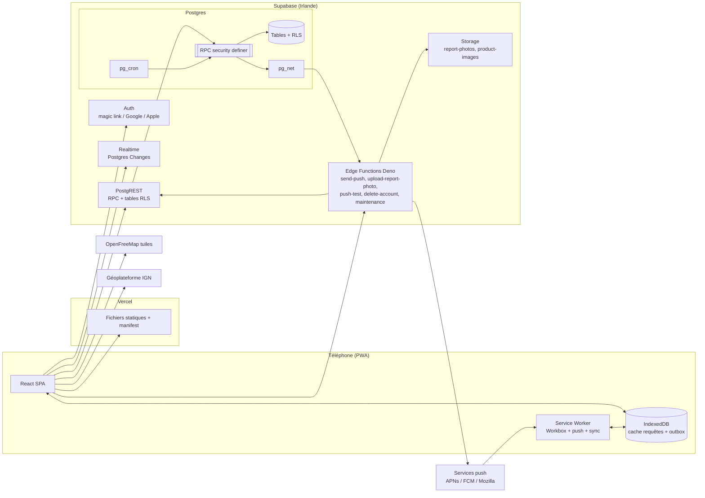
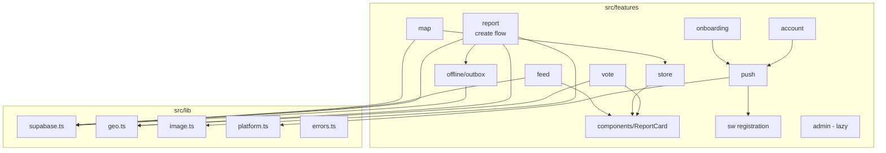
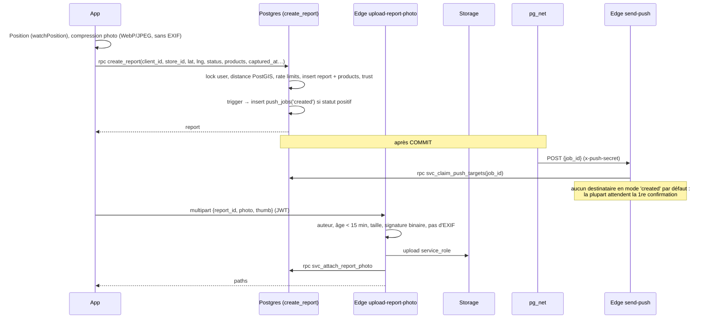
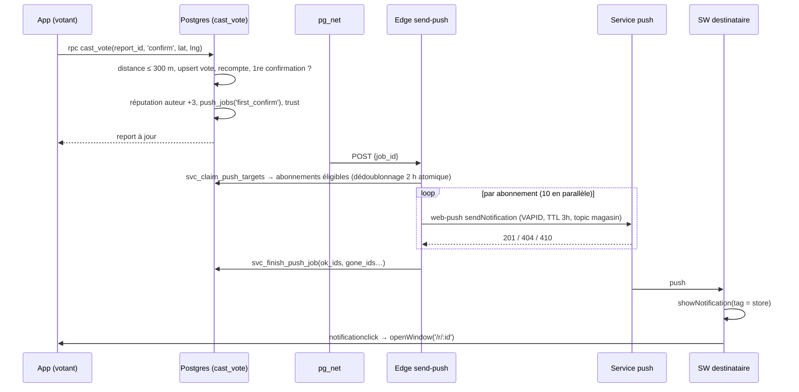
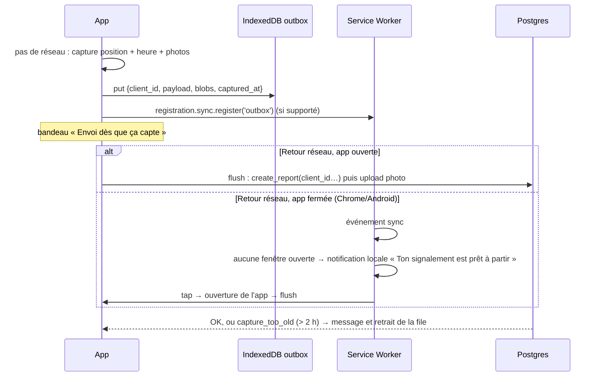
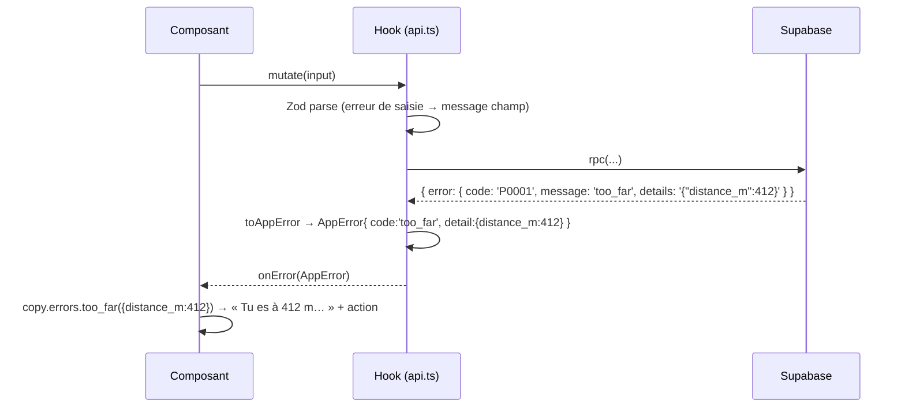

# RestockRadar Fullstack Architecture Document

> Agent : Architect (Winston) — BMAD v4.33 — v0.2 du 2026-10-14 — décisions D1 à D4 validées par le porteur
> Entrées : [`docs/prd.md`](prd.md) v0.4, [`docs/front-end-spec.md`](front-end-spec.md) v1.0, [`docs/brief.md`](brief.md) v0.2.

## Introduction

Ce document décrit l'architecture complète de RestockRadar : front PWA, back Supabase, données, sécurité, déploiement et tests. C'est la source de vérité pour les agents de développement. Il contient les trois livrables exigés par le porteur avant tout code : **l'arborescence** (Source Tree), **le schéma SQL complet avec les policies RLS** (Database Schema) et **la liste des Edge Functions** (Backend Architecture). Le découpage en phases suit les epics du PRD.

### Starter Template or Existing Project
Projet greenfield, sans starter tiers. Initialisation par `npm create vite@latest` (template `react-ts`) puis ajout manuel des briques, pour garder la maîtrise du bundle. Le back est initialisé par `supabase init`.

### Change Log
| Date | Version | Description | Author |
|---|---|---|---|
| 2026-10-14 | 0.1 | Version initiale, soumise au porteur | Architect (Winston) |
| 2026-10-14 | 0.2 | D1 Tailwind v4, D2 Vercel, D3 Resend, D4 photos 60 j : validés | Architect (Winston) |

## High Level Architecture

### Technical Summary
RestockRadar est une **SPA React servie en statique** (Vercel), transformée en **PWA** par un service worker Workbox (stratégie `injectManifest`) qui gère aussi les push et la file hors ligne. Toute la logique métier sensible vit dans **Postgres** (Supabase), sous forme de **fonctions RPC `SECURITY DEFINER`** protégées par une **RLS stricte**. **PostGIS** fournit les distances, **`pg_cron`** les tâches planifiées et **`pg_net`** les appels sortants vers les **Edge Functions Deno**. Ces fonctions couvrent ce que la base ne peut pas faire seule : envoi Web Push, contrôle et stockage des photos, suppression de compte, maintenance du stockage. Le fil temps réel passe par **Supabase Realtime** (Postgres Changes), et la carte par **MapLibre** avec les tuiles **OpenFreeMap** et un style maison. L'ensemble tient dans les offres gratuites, avec des points de vigilance listés plus bas (e-mails, stockage photo, mise en pause).

### Platform and Infrastructure Choice
**Plateforme :** Supabase (offre Free) pour le back, et **Vercel (offre Hobby) — à valider** — pour le front.
**Services utilisés :**
- Supabase : Postgres 15+ (PostGIS, pg_cron, pg_net, citext), Auth (magic link, Google, Apple), Storage, Realtime, Edge Functions, Vault.
- OpenFreeMap : tuiles vectorielles OSM, glyphes et sprites.
- Géoplateforme IGN : géocodage de la ville ou du code postal, gratuit et sans clé.
- Overpass API : import ponctuel des magasins.
- Resend : SMTP des e-mails d'authentification (offre gratuite).

**Région :** Supabase `eu-west-1` (Irlande). Le projet a été créé dans cette région (et non à Paris comme prévu initialement) : c'est conforme au RGPD (UE), avec une latence légèrement supérieure et négligeable. Vercel sert le front depuis son CDN mondial.

**Décisions du porteur (2026-10-14 : Tailwind v4, Vercel, rétention des photos 60 jours validés ; SMTP (D3) reporté avant ouverture publique)**

| # | Sujet | Recommandation | Alternative |
|---|---|---|---|
| D1 | Version de Tailwind | **v4** : tokens déclarés directement en CSS (`@theme`), plus besoin de `tailwind.config`, build plus rapide | v3 avec la config JS classique |
| D2 | Hébergeur front | **Vercel** : déjà utilisé sur tes autres projets, previews par branche. L'offre Hobby est réservée à l'usage non commercial, ce qui convient tant qu'il n'y a pas de monétisation | Netlify (usage commercial autorisé en gratuit) |
| D3 | E-mails d'auth | **SMTP Resend obligatoire** : l'expéditeur par défaut de Supabase est limité à quelques e-mails par heure et seulement vers les membres de l'équipe | Brevo ou un autre SMTP |
| D4 | Rétention des photos | **Purge automatique des photos après 60 jours** (le signalement reste, sans photo). Le stockage gratuit est de 1 Go, et une photo pèse environ 280 Ko avec sa vignette | 30 ou 90 jours |

**Écarts techniques imposés, à reporter dans le PRD**
1. **Géocodage :** l'API Adresse (`api-adresse.data.gouv.fr`) a été décommissionnée fin janvier 2026 au profit du **géocodeur de la Géoplateforme IGN** (`data.geopf.fr/geocodage`), fonctionnellement identique.
2. **Photos sur iOS :** Safari ne sait pas encoder en WebP via canvas (il renvoie du PNG). Le client produit du **WebP si le navigateur le supporte, sinon du JPEG** (qualité 0,82). L'EXIF est supprimé dans les deux cas, et le serveur le vérifie.
3. **Vignettes :** les transformations d'images Supabase sont réservées aux offres payantes. Le client envoie donc **deux fichiers** (1600 px et 480 px).
4. **`web-push` sous Deno :** la librairie repose sur des API Node (`crypto.createECDH`, `https`). Un spike est prévu à la story 1.6. En cas d'échec, l'architecte proposera au porteur une librairie Web Crypto compatible Deno (`@pushforge/builder` ou `web-push-browser`), sans rien changer sans son accord.
5. **Modèle de données :** `alert_radius_km` et `home_area` sortent de `profiles`, qui est lisible publiquement, pour aller dans `alert_preferences` et `user_settings`, lisibles par leur seul propriétaire. Une position, même arrondie, ne doit jamais être publique.

### Repository Structure
**Structure :** monorepo simple, sans workspaces : front à la racine, back dans `supabase/`, scripts Node dans `scripts/`.
**Monorepo Tool :** aucun (npm scripts).
**Package Organization :** un seul `package.json`. Les Edge Functions sont du Deno indépendant, avec leurs imports `npm:` et `jsr:` épinglés et un `_shared/` commun.

### High Level Architecture Diagram



### Architectural Patterns
- **Jamstack + BaaS :** SPA statique avec un back managé. *Rationale :* coût nul, aucun serveur à maintenir, scalabilité gérée par les fournisseurs.
- **Logique métier en base (« fat database ») :** les règles (distance, rate limits, votes, réputation, trust score) sont des fonctions Postgres atomiques. *Rationale :* une seule source de vérité, transactions et verrous natifs, impossible à contourner depuis un client modifié (NFR6).
- **RLS par défaut, RPC pour l'écriture :** les tables sensibles n'acceptent aucune écriture directe, tout passe par une RPC. *Rationale :* la validation et les effets de bord (compteurs, réputation, jobs push) restent cohérents.
- **Outbox transactionnelle pour les push :** un `push_jobs` est inséré dans la même transaction que l'évènement, puis `pg_net` part après commit, avec reprise par cron. *Rationale :* aucune notification pour une transaction annulée, et reprise automatique en cas d'échec.
- **Fonctions service (`svc_*`) :** les wrappers publics que seule la `service_role` peut exécuter sont l'unique passerelle des Edge Functions vers la logique privée. *Rationale :* le schéma `private` n'est pas exposé par l'API.
- **Feature folders côté front :** `src/features/<domaine>`, chacun avec ses composants, hooks, requêtes et schémas. *Rationale :* les stories sont des tranches verticales et chaque agent travaille dans un périmètre clair.
- **Server state via TanStack Query, UI state minimal (Zustand) :** *Rationale :* cache, invalidation, optimistic updates et persistance hors ligne, sans store global lourd.
- **Offline-first ciblé :** persistance du cache de requêtes et file d'envoi locale idempotente (`client_id`). *Rationale :* réseau faible au fond des hypermarchés (FR40-41).

## Tech Stack

Les versions sont **épinglées à la story 1.1** (dernière version stable de la majeure indiquée, `package-lock.json` versionné). La table ci-dessous est la référence que tout agent doit respecter.

### Technology Stack Table
| Category | Technology | Version | Purpose | Rationale |
|---|---|---|---|---|
| Frontend Language | TypeScript | 5.x (strict) | Typage du front et des scripts | Imposé, sécurité de refactor |
| Frontend Framework | React | 19.x | UI | Imposé |
| Build | Vite | dernière majeure stable | Bundling, dev server | Imposé, rapide |
| UI Component Library | Composants maison + `vaul` (feuilles) + `@radix-ui/react-dialog` | dernière | Primitives accessibles sans style | Pas de look shadcn par défaut (front-end spec) |
| CSS | Tailwind CSS | **4.x (D1)** | Utilitaires branchés sur les tokens | Imposé, tokens via `@theme` |
| Icônes | `@phosphor-icons/react` (Bold) | 2.x | Iconographie | Front-end spec |
| State Management | TanStack Query + Zustand | 5.x / 5.x | État serveur / préférences UI | Imposé (Query) ; Zustand ~1 ko |
| Persistance hors ligne | `@tanstack/query-persist-client-core` + `idb-keyval` | 5.x / 6.x | Cache des requêtes et outbox en IndexedDB | FR40-41 |
| Routing | React Router | 7.x (data router) | Routes, lazy loading | Imposé |
| Carte | MapLibre GL JS | 5.x | Rendu vectoriel, clusters | Imposé, sans clé |
| Tuiles | OpenFreeMap | — | Tuiles OSM, glyphes | Gratuit, sans clé |
| Horaires | `opening_hours` (npm) | 3.x | Parsing du format OSM | Chargé à la demande sur la fiche magasin |
| Validation | Zod | 4.x | Schémas des formulaires, de l'env, des réponses et des Edge Functions | Imposé |
| PWA | `vite-plugin-pwa` + Workbox | 1.x / 7.x | Manifest, precache, SW | Imposé |
| Assets PWA | `@vite-pwa/assets-generator` | 1.x | Icônes et splash iOS | Génère toutes les tailles |
| Backend Language | SQL (PL/pgSQL) + TypeScript (Deno) | PG 15+ / Deno 2 | RPC, triggers / Edge Functions | Imposé |
| Backend Framework | Supabase | CLI 2.x, supabase-js 2.x | BaaS | Imposé |
| API Style | PostgREST (tables + RPC) + Realtime + Edge Functions HTTP | — | Accès données | Natif Supabase |
| Database | Postgres + PostGIS + pg_cron + pg_net + citext | PG 15+ | Données, géo, cron, HTTP | Imposé |
| File Storage | Supabase Storage | — | Photos, images produits | Imposé |
| Authentication | Supabase Auth | — | Magic link, Google, Apple | Imposé |
| Push | `web-push` (npm, via `npm:`) | 3.x | Web Push VAPID | **Imposé, spike story 1.6** |
| Frontend Testing | Vitest + Testing Library | dernière | Logique pure, composants | Imposé |
| Backend Testing | Vitest (intégration supabase-js sur `supabase start`) | dernière | RPC, RLS, triggers | Teste comme le client réel |
| E2E Testing | Playwright + `@axe-core/playwright` | 1.x | 4 parcours + a11y | Imposé |
| Lint / Format | ESLint (flat config) + Prettier | 9.x / 3.x | Qualité | Imposé |
| Bundle budget | `size-limit` | 11.x | Bundle initial < 200 ko gzip en CI | NFR3 |
| CI/CD | GitHub Actions + intégration Git Vercel | — | Checks, tests, deploy | Gratuit |
| Monitoring | Logs Supabase + tables internes + panneau admin « Santé » | — | Observabilité sans tracker tiers | NFR7 |
| Logging front | RPC `log_client_error` (limitée) | — | Erreurs JS en base | Aucun SaaS tiers |

## Data Models

Modèles partagés (types générés par `supabase gen types typescript` dans `src/types/database.ts`, puis aliasés dans `src/types/domain.ts`).

### Profile (public)
**Purpose :** identité publique d'un contributeur.
**Key Attributes :** `id` (= auth.uid), `pseudo` (unique, insensible à la casse), `avatar_key` (avatar maison), `reputation_score`, `reports_count`, `reports_disputed_count`, `scout_count`, `role` (`user` | `admin`), `banned_at` (non exposé).

```typescript
export interface Profile {
  id: string;
  pseudo: string;
  avatarKey: string;
  reputationScore: number;
  reportsCount: number;
  reportsDisputedCount: number;
  scoutCount: number;
  role: 'user' | 'admin';
  badges: BadgeKey[]; // computed: 'nouveau' | 'fiable' | 'eclaireur' | 'veteran'
  createdAt: string;
}
```
**Relationships :** 1-1 avec `user_settings` et `alert_preferences`, 1-n avec `reports`, `report_votes`, `push_subscriptions` et `store_favorites`.

### UserSettings / AlertPreferences (privés)
**Purpose :** zone de référence (arrondie à ~1 km) et filtres d'alerte. Lisibles par leur seul propriétaire.

```typescript
export interface AlertPreferences {
  userId: string;
  enabled: boolean;
  radiusKm: number;            // 1..50, default 15
  trigger: 'created' | 'first_confirm'; // default 'first_confirm'
  productIds: string[];
  productTypes: ProductType[];
  brandIds: string[];
  favoritesOnly: boolean;
  quietStart: string | null;   // 'HH:MM' Europe/Paris
  quietEnd: string | null;
}
```

### Store
**Purpose :** magasin physique (import OSM ou proposition d'un utilisateur).

```typescript
export interface Store {
  id: string;
  osmRef: string | null;       // 'node/123' | 'way/456'
  name: string;
  brandId: string | null;
  address: string | null;
  city: string | null;
  postcode: string | null;
  department: string;          // '84', '13'…
  lng: number; lat: number;
  openingHours: string | null; // OSM opening_hours syntax
  status: 'pending' | 'active' | 'rejected' | 'disabled';
}
```
**Relationships :** n-1 vers `brands`, 1-n vers `reports` et `store_slot_stats`.

### Brand / Game / Product
**Purpose :** référentiels éditables par l'admin. `games` prépare les autres TCG, `brands.category_color` porte la palette secondaire « types ».

```typescript
export type ProductType = 'booster' | 'blister' | 'display' | 'etb' | 'coffret' | 'tin' | 'bundle' | 'other';
export interface Product { id: string; gameId: string; name: string; type: ProductType; setName: string | null; imagePath: string | null; sortOrder: number; isActive: boolean; }
```

### Report
**Purpose :** signalement d'un statut de stock dans un magasin, à un instant donné.

```typescript
export type ReportStatus = 'in_stock' | 'low_stock' | 'out_of_stock' | 'restock_incoming';
export type ReportState = 'active' | 'sold_out' | 'disputed' | 'expired' | 'hidden';
export interface Report {
  id: string;
  clientId: string;            // idempotency key generated on device
  storeId: string;
  userId: string | null;       // null once author deleted their account
  status: ReportStatus;
  state: ReportState;
  priceCents: number | null;
  comment: string | null;
  photoPath: string | null; thumbPath: string | null;
  reporterDistanceM: number;
  isRemote: boolean;
  isFirstOfDay: boolean;
  reportedAt: string;          // observation time (captured on device, validated server-side)
  createdAt: string;           // server insert time (rate limits)
  expiresAt: string;
  confirmCount: number; denyCount: number; soldOutCount: number;
  firstConfirmedAt: string | null;
  trustScore: number;          // 0..100
}
```
**Relationships :** n-n avec `products` via `report_products` (avec `qty_estimate`), 1-n avec `report_votes` et `moderation_flags`.

### ReportVote, PushSubscription, ModerationFlag, StoreSlotStats
Voir le schéma SQL. `StoreSlotStats` (jour × créneau de 2 h, compteurs sur 90 jours et depuis l'origine) alimente la heatmap en V1 et **la prédiction en V2**.

## API Specification

Il n'y a pas d'API REST maison : le client parle à **PostgREST** (tables en lecture sous RLS, RPC pour l'écriture), à **Realtime** et à **5 Edge Functions**. Le contrat est défini par les signatures SQL ci-dessous et les types générés.

### RPC exposées (schéma `public`)

| RPC | Rôle autorisé | Description |
|---|---|---|
| `get_public_config()` | anon, authenticated | Seuils non secrets (distances, TTL, seuil holo, seuil heatmap) |
| `get_me()` | authenticated | Profil complet de l'appelant (dont `banned`) + réglages + préférences |
| `get_launch_stores()` | anon, authenticated | Tous les magasins actifs des départements lancés + statut courant (≈ 1 000 lignes, mis en cache 24 h) |
| `get_stores_in_bbox(min_lng, min_lat, max_lng, max_lat)` | anon, authenticated | Même chose par emprise (utilisé quand on étendra à la France) |
| `get_feed(lat, lng, radius_km, product_ids, brand_ids, max_age_min, before, limit)` | anon, authenticated | Fil paginé (curseur `before` = `reported_at`) |
| `get_store_heatmap(store_id)` | anon, authenticated | `{ enough, total_90d, cells[] }` |
| `create_report(client_id, store_id, lat, lng, status, products, price_cents, comment, captured_at)` | authenticated | Crée un signalement (toutes les règles serveur) |
| `cast_vote(report_id, vote, lat, lng)` | authenticated | Vote sur place, règles « Plus rien » et « contesté » |
| `propose_store(name, brand_id, address, city, postcode, lat, lng)` | authenticated | Magasin `pending` |
| `find_store_duplicates(lat, lng, brand_id)` | authenticated | Magasins de même enseigne à moins de 100 m |
| `flag_content(report_id, target, reason, note)` | authenticated | Signalement d'abus |
| `get_my_export()` | authenticated | Export JSON RGPD |
| `log_client_error(message, stack, url)` | anon, authenticated | Journal d'erreurs JS (limité) |
| `admin_review_store(store_id, decision, note, patch)` | authenticated + admin | Valider, refuser ou modifier |
| `admin_moderate(report_id, action, flag_ids)` | authenticated + admin | `hide_report` / `unhide_report` / `hide_photo` / `dismiss` |
| `admin_set_ban(user_id, banned)` | authenticated + admin | Bannir ou débannir |
| `admin_health()` | authenticated + admin | Derniers runs cron, stats push, KPIs |
| `svc_claim_push_targets(job_id)` | service_role | Ciblage et dédoublonnage atomique des push |
| `svc_finish_push_job(job_id, sent, ok_ids, gone_ids, failed)` | service_role | Clôture du job, purge des endpoints morts |
| `svc_attach_report_photo(report_id, user_id, photo_path, thumb_path)` | service_role | Rattache les photos validées |
| `svc_prepare_account_deletion(user_id)` | service_role | Anonymise et renvoie les chemins de photos à supprimer |
| `svc_photos_to_purge(older_than_days)` | service_role | Liste des photos expirées (rétention D4) |

**Format d'erreur RPC :** `raise exception using errcode = 'P0001', message = '<code>', detail = '<json>'`. Les codes sont stables, en `snake_case` : `auth_required`, `banned`, `store_not_found`, `too_far`, `rate_limited_user`, `rate_limited_store`, `capture_too_old`, `invalid_products`, `report_not_found`, `own_report`, `report_expired`, `forbidden`, `client_id_conflict`. Le `detail` porte un JSON (`{"distance_m":412}`, `{"retry_in_min":12}`). Le front traduit chaque code via `src/copy/fr.ts`.

### Edge Functions (HTTP)

| Fonction | Auth | Méthode et entrée | Sortie |
|---|---|---|---|
| `send-push` | en-tête `x-push-secret` (appel interne `pg_net` / cron) | `POST { job_id }` | `{ sent, gone, failed }` |
| `upload-report-photo` | JWT utilisateur | `POST multipart { report_id, photo, thumb }` | `{ photo_path, thumb_path }` |
| `push-test` | JWT utilisateur | `POST {}` | `{ sent }` |
| `delete-account` | JWT utilisateur | `POST { confirm: "SUPPRIMER" }` | `204` |
| `maintenance` | en-tête `x-push-secret` (cron quotidien) | `POST { task: "purge_photos" \| "purge_dead_subscriptions" }` | `{ purged }` |

Erreurs Edge : `{ "error": { "code": "...", "message": "..." } }` avec le statut HTTP correspondant (400, 401, 403, 404, 413, 415, 422, 429, 500).

## Components

### Web App (SPA React)
**Responsibility :** UI, cache des données, géolocalisation à la volée, compression des photos, file hors ligne.
**Key Interfaces :** routes React Router, hooks `use*Query` / `use*Mutation`, client Supabase unique.
**Dependencies :** Supabase (Auth, REST, Realtime, Edge), OpenFreeMap, Géoplateforme.
**Technology Stack :** React, Vite, Tailwind, TanStack Query, Zustand, MapLibre (lazy).

### Service Worker
**Responsibility :**
- precache de la coquille ;
- cache d'exécution (tuiles, photos, polices) ;
- réception des push (`push`), ouverture (`notificationclick` → `/r/:id`) ;
- réveil Background Sync (`sync` → demande au client de vider l'outbox) ;
- invite de mise à jour.

**Technology Stack :** Workbox 7 via `vite-plugin-pwa` en `injectManifest` (`src/sw/service-worker.ts`).

### Postgres (logique métier)
**Responsibility :** données, RLS, RPC, triggers (compteurs, réputation, outbox push), cron (expiration, statistiques, reprise des push).
**Key Interfaces :** RPC listées plus haut, publication Realtime sur `reports`.

### Edge Functions
**Responsibility :** ce que Postgres ne sait pas faire : chiffrement Web Push, validation binaire et écriture Storage, suppression d'un utilisateur Auth, purge Storage.

### Scripts Node (hors runtime)
`scripts/import-osm.ts`, `scripts/generate-vapid.mjs`, `scripts/seed-demo.ts` (local uniquement), `scripts/gen-pwa-assets` (via le CLI assets-generator).

### Component Diagrams



## External APIs

### OpenFreeMap
- **Purpose :** tuiles vectorielles, glyphes et sprites pour MapLibre.
- **Documentation :** https://openfreemap.org
- **Base URL(s) :** `https://tiles.openfreemap.org/planet` (source vectorielle), `https://tiles.openfreemap.org/fonts/{fontstack}/{range}.pbf`
- **Authentication :** aucune.
- **Rate Limits :** pas de quota publié (service communautaire gratuit). Nous mettons les tuiles en cache (300 entrées, 14 jours).
- **Integration Notes :** **nos deux styles JSON** (`public/map/style-light.json`, `public/map/style-dark.json`) sont dérivés du style « positron » et recolorés aux tokens papier et encre. L'attribution « © OpenFreeMap © OpenStreetMap » est obligatoire.

### Géoplateforme IGN — géocodage
- **Purpose :** convertir une ville ou un code postal en coordonnées (repli si la position est refusée) et autocompléter l'adresse lors d'une proposition de magasin.
- **Documentation :** https://geoservices.ign.fr/documentation/services/services-geoplateforme/geocodage
- **Base URL(s) :** `https://data.geopf.fr/geocodage`
- **Authentication :** aucune.
- **Rate Limits :** 50 requêtes par seconde et par IP (hérité de l'API Adresse). Saisie débouncée à 300 ms.
- **Key Endpoints Used :**
  - `GET /search?q=&index=address&type=municipality&limit=5` : villes et codes postaux ;
  - `GET /search?q=&index=address&limit=5` : adresses.
- **Integration Notes :** l'URL est paramétrable (`VITE_GEOCODER_URL`). Les réponses sont en GeoJSON, comme l'ancienne API Adresse.

### Overpass API (OSM)
- **Purpose :** import initial et rafraîchissement des magasins.
- **Base URL(s) :** `https://overpass-api.de/api/interpreter`
- **Rate Limits :** usage raisonnable, 1 requête par département, avec pause et retry exponentiel en cas de 429.
- **Integration Notes :** voir le paragraphe « Import OSM ». Licence ODbL, attribution sur la carte.

### Web Push (APNs, FCM, Mozilla autopush)
- **Purpose :** distribution des notifications. L'endpoint est fourni par le navigateur.
- **Authentication :** VAPID (clé publique côté client, clé privée en secret Edge).
- **Integration Notes :** `TTL` de 3 h (une info de stock vieillit vite), `urgency: high`, `topic` = magasin (une nouvelle notification remplace la précédente non lue sur le même magasin). Un 404 ou 410 supprime l'abonnement.

## Core Workflows

### Créer un signalement (en ligne)



### Vote et première confirmation → push



### Signalement hors ligne



*Choix assumé :* le service worker n'envoie pas lui-même les signalements. La session Supabase vit dans le contexte de la page, et la rafraîchir depuis le SW ferait tourner le refresh token en concurrence avec la page, avec un risque de déconnexion. Background Sync sert donc de **réveil**, pas de transport.

### Temps réel du fil
Le client s'abonne à `postgres_changes` (INSERT et UPDATE) sur `public.reports`. La RLS s'applique : un signalement masqué n'est jamais diffusé. Chaque évènement est filtré **côté client** : on ne garde que les `store_id` présents dans la liste des magasins chargée en cache (`get_launch_stores`), puis on applique la distance au centre de l'utilisateur (haversine, `src/lib/geo.ts`) et les filtres actifs. Une fois les informations du magasin et des produits complétées via `feed_reports`, la pastille « N nouveaux signalements » s'incrémente. L'abonnement se coupe au passage en arrière-plan (`visibilitychange`) et le rattrapage se fait au retour par refetch du fil. *Passage à l'échelle nationale :* canaux Realtime **Broadcast par département**, alimentés par trigger, au lieu des Postgres Changes globaux.

## Database Schema

Ci-dessous, le **schéma complet** (migrations `supabase/migrations/*.sql`). Conventions : tables en `snake_case` au pluriel, `uuid` par défaut, `timestamptz` partout, toutes les fonctions avec `search_path` fixé. Le schéma `private` n'est **pas** exposé par PostgREST.

### 0001_extensions_and_schemas.sql
```sql
create extension if not exists postgis  with schema extensions;
create extension if not exists citext   with schema extensions;
create extension if not exists pg_net   with schema extensions;
create extension if not exists pg_cron;

create schema if not exists private;
-- private objects are reachable only through security definer functions,
-- except a few read-only helpers explicitly granted below (used inside RLS policies).
grant usage on schema private to anon, authenticated, service_role;
alter default privileges in schema private revoke execute on functions from public;
alter default privileges in schema public  revoke execute on functions from public, anon;

create type public.report_status as enum ('in_stock','low_stock','out_of_stock','restock_incoming');
create type public.report_state  as enum ('active','sold_out','disputed','expired','hidden');
create type public.vote_kind     as enum ('confirm','deny','sold_out_now');
create type public.store_status  as enum ('pending','active','rejected','disabled');
create type public.product_type  as enum ('booster','blister','display','etb','coffret','tin','bundle','other');
create type public.app_role      as enum ('user','admin');
create type public.flag_reason   as enum ('fake','inappropriate_photo','spam','other');
create type public.flag_status   as enum ('open','actioned','dismissed');
create type public.push_trigger  as enum ('created','first_confirm');
```

### 0002_config.sql
```sql
create table private.app_config (
  key        text primary key,
  value      jsonb not null,
  is_public  boolean not null default false,
  updated_at timestamptz not null default now()
);

insert into private.app_config (key, value, is_public) values
  ('report_max_distance_m',     '300',  true),
  ('vote_max_distance_m',       '300',  true),
  ('report_ttl_hours',          '6',    true),
  ('rate_reports_per_hour',     '10',   true),
  ('rate_store_cooldown_min',   '30',   true),
  ('offline_max_delay_min',     '120',  true),
  ('remote_min_reputation',     '150',  true),
  ('remote_min_reliability',    '0.9',  true),
  ('reliable_min_reputation',   '30',   true),
  ('reliable_min_reliability',  '0.8',  true),
  ('scout_min_count',           '10',   true),
  ('veteran_min_reputation',    '150',  true),
  ('newbie_max_reputation',     '10',   true),
  ('heatmap_min_reports_90d',   '8',    true),
  ('holo_min_trust',            '80',   true),
  ('push_dedupe_hours',         '2',    false),
  ('photo_retention_days',      '60',   true),
  ('launch_departments',        '["84","13"]', true);

create function private.cfg_num(p_key text) returns numeric
language sql stable security definer set search_path = '' as $$
  select (value #>> '{}')::numeric from private.app_config where key = p_key
$$;
create function private.cfg_int(p_key text) returns int
language sql stable security definer set search_path = '' as $$
  select (value #>> '{}')::numeric::int from private.app_config where key = p_key
$$;
grant execute on function private.cfg_num(text), private.cfg_int(text) to anon, authenticated, service_role;

create table private.reputation_rules (kind text primary key, points int not null);
insert into private.reputation_rules values
  ('report_first_confirm', 3), ('report_extra_confirm', 1), ('report_confirm_cap', 6),
  ('photo_kept', 1), ('vote_coherent', 1), ('report_disputed', -4), ('moderated', -10);
```

### 0003_profiles_and_settings.sql
```sql
create table public.profiles (
  id                     uuid primary key references auth.users(id) on delete cascade,
  pseudo                 extensions.citext not null unique
                         check (pseudo ~ '^[A-Za-z0-9_À-ÿ-]{3,20}$'),
  avatar_key             text not null default 'lamp-1',
  role                   public.app_role not null default 'user',
  reputation_score       int not null default 0 check (reputation_score >= 0),
  reports_count          int not null default 0,
  reports_disputed_count int not null default 0,
  scout_count            int not null default 0,
  banned_at              timestamptz,
  created_at             timestamptz not null default now()
);

create table public.user_settings (
  user_id      uuid primary key references public.profiles(id) on delete cascade,
  home_area    extensions.geography(Point, 4326),   -- snapped to a ~1 km grid by trigger
  home_label   text,
  onboarded_at timestamptz,
  updated_at   timestamptz not null default now()
);

create table public.alert_preferences (
  user_id        uuid primary key references public.profiles(id) on delete cascade,
  enabled        boolean not null default true,
  radius_km      smallint not null default 15 check (radius_km between 1 and 50),
  trigger        public.push_trigger not null default 'first_confirm',
  product_ids    uuid[] not null default '{}',
  product_types  public.product_type[] not null default '{}',
  brand_ids      uuid[] not null default '{}',
  favorites_only boolean not null default false,
  quiet_start    time,
  quiet_end      time,
  updated_at     timestamptz not null default now(),
  check ((quiet_start is null) = (quiet_end is null))
);

-- helpers used by RLS policies
create function private.is_admin() returns boolean
language sql stable security definer set search_path = '' as $$
  select exists (select 1 from public.profiles
                 where id = auth.uid() and role = 'admin' and banned_at is null)
$$;
create function private.is_active_user() returns boolean
language sql stable security definer set search_path = '' as $$
  select exists (select 1 from public.profiles where id = auth.uid() and banned_at is null)
$$;
grant execute on function private.is_admin(), private.is_active_user() to anon, authenticated;

create function private.reliability(p public.profiles) returns numeric
language sql immutable set search_path = '' as $$
  select case when p.reports_count = 0 then 1
              else 1 - p.reports_disputed_count::numeric / p.reports_count end
$$;
create function private.is_reliable(p public.profiles) returns boolean
language sql stable set search_path = '' as $$
  select p.reputation_score >= private.cfg_int('reliable_min_reputation')
     and private.reliability(p) >= private.cfg_num('reliable_min_reliability')
$$;
create function private.can_report_remotely(p public.profiles) returns boolean
language sql stable set search_path = '' as $$
  select p.reputation_score >= private.cfg_int('remote_min_reputation')
     and private.reliability(p) >= private.cfg_num('remote_min_reliability')
$$;
grant execute on function private.reliability(public.profiles), private.is_reliable(public.profiles)
  to anon, authenticated;

-- computed field exposed by PostgREST: select=*,badges
create function public.badges(p public.profiles) returns text[]
language sql stable set search_path = '' as $$
  select array_remove(array[
    case when p.reputation_score <  private.cfg_int('newbie_max_reputation')  then 'nouveau'   end,
    case when private.is_reliable(p)                                          then 'fiable'    end,
    case when p.scout_count      >= private.cfg_int('scout_min_count')        then 'eclaireur' end,
    case when p.reputation_score >= private.cfg_int('veteran_min_reputation') then 'veteran'   end
  ], null)
$$;
grant execute on function public.badges(public.profiles) to anon, authenticated;

create function private.snap_home_area() returns trigger
language plpgsql set search_path = '' as $$
begin
  if new.home_area is not null then
    new.home_area := extensions.st_snaptogrid(new.home_area::extensions.geometry, 0.01)::extensions.geography;
  end if;
  new.updated_at := now();
  return new;
end $$;
create trigger user_settings_snap before insert or update of home_area on public.user_settings
  for each row execute function private.snap_home_area();

create function private.handle_new_user() returns trigger
language plpgsql security definer set search_path = '' as $$
declare v_pseudo text; v_try int := 0;
begin
  loop
    v_pseudo := 'Chasseur' || lpad(floor(random() * 10000)::int::text, 4, '0');
    begin
      insert into public.profiles (id, pseudo) values (new.id, v_pseudo);
      exit;
    exception when unique_violation then
      v_try := v_try + 1;
      if v_try >= 8 then
        insert into public.profiles (id, pseudo)
        values (new.id, 'Chasseur' || substr(replace(new.id::text, '-', ''), 1, 10));
        exit;
      end if;
    end;
  end loop;
  insert into public.user_settings (user_id) values (new.id);
  insert into public.alert_preferences (user_id) values (new.id);
  return new;
end $$;
create trigger on_auth_user_created after insert on auth.users
  for each row execute function private.handle_new_user();
```

### 0004_catalog_and_stores.sql
```sql
create table public.games (
  id uuid primary key default gen_random_uuid(),
  slug text not null unique,
  name text not null,
  is_active boolean not null default true
);

create table public.brands (
  id             uuid primary key default gen_random_uuid(),
  slug           text not null unique,
  name           text not null,
  kind           text not null check (kind in ('hypermarket','supermarket','culture','toys','video_games','tcg_shop','other')),
  category_color text not null default 'roche'
                 check (category_color in ('feu','eau','plante','electrik','psy','roche')),
  osm_match      text[] not null default '{}'   -- normalized brand/name patterns used by the OSM import
);

create table public.products (
  id         uuid primary key default gen_random_uuid(),
  game_id    uuid not null references public.games(id),
  name       text not null check (char_length(name) between 2 and 80),
  type       public.product_type not null,
  set_name   text check (char_length(set_name) <= 80),
  image_path text,
  sort_order int not null default 100,
  is_active  boolean not null default true,
  created_at timestamptz not null default now()
);
create index products_active_idx on public.products (is_active, sort_order);

create table public.stores (
  id            uuid primary key default gen_random_uuid(),
  osm_ref       text unique,
  name          text not null check (char_length(name) between 2 and 120),
  brand_id      uuid references public.brands(id),
  address       text,
  city          text,
  postcode      text check (postcode ~ '^[0-9]{5}$'),
  department    text not null check (department ~ '^(2A|2B|[0-9]{2,3})$'),
  location      extensions.geography(Point, 4326) not null,
  opening_hours text,
  status        public.store_status not null default 'pending',
  created_by    uuid references public.profiles(id) on delete set null,
  reviewed_by   uuid references public.profiles(id) on delete set null,
  review_note   text,
  created_at    timestamptz not null default now(),
  updated_at    timestamptz not null default now()
);
create index stores_location_gix on public.stores using gist (location);
create index stores_status_dept_idx on public.stores (status, department);

create table public.store_favorites (
  user_id    uuid not null references public.profiles(id) on delete cascade,
  store_id   uuid not null references public.stores(id) on delete cascade,
  created_at timestamptz not null default now(),
  primary key (user_id, store_id)
);
```

### 0005_reports_and_votes.sql
```sql
create table public.reports (
  id                  uuid primary key default gen_random_uuid(),
  client_id           uuid not null unique,
  store_id            uuid not null references public.stores(id),
  user_id             uuid references public.profiles(id) on delete set null,
  status              public.report_status not null,
  state               public.report_state not null default 'active',
  price_cents         int check (price_cents between 0 and 100000),
  comment             varchar(140),
  photo_path          text,
  thumb_path          text,
  photo_hidden        boolean not null default false,
  reporter_distance_m int not null check (reporter_distance_m >= 0),
  is_remote           boolean not null default false,
  is_first_of_day     boolean not null default false,
  reported_at         timestamptz not null,               -- observation time
  created_at          timestamptz not null default now(), -- insert time
  expires_at          timestamptz not null,
  confirm_count       int not null default 0,
  deny_count          int not null default 0,
  sold_out_count      int not null default 0,
  first_confirmed_at  timestamptz,
  trust_score         smallint not null default 0 check (trust_score between 0 and 100),
  finalized_at        timestamptz
);
create index reports_store_recent_idx on public.reports (store_id, reported_at desc);
create index reports_live_idx on public.reports (reported_at desc) where finalized_at is null;
create index reports_user_created_idx on public.reports (user_id, created_at desc);
create index reports_to_finalize_idx on public.reports (expires_at) where finalized_at is null;

create table public.report_products (
  report_id    uuid not null references public.reports(id) on delete cascade,
  product_id   uuid not null references public.products(id),
  qty_estimate smallint check (qty_estimate between 1 and 999),
  primary key (report_id, product_id)
);

create table public.report_votes (
  report_id  uuid not null references public.reports(id) on delete cascade,
  user_id    uuid not null references public.profiles(id) on delete cascade,
  vote       public.vote_kind not null,
  distance_m int not null,
  created_at timestamptz not null default now(),
  updated_at timestamptz not null default now(),
  primary key (report_id, user_id)
);

alter publication supabase_realtime add table public.reports;

create table private.reputation_events (
  id         bigint generated always as identity primary key,
  user_id    uuid not null references public.profiles(id) on delete cascade,
  kind       text not null references private.reputation_rules(kind),
  points     int not null,
  report_id  uuid references public.reports(id) on delete set null,
  dedupe_key text not null unique,
  created_at timestamptz not null default now()
);

create table public.store_slot_stats (
  store_id   uuid not null references public.stores(id) on delete cascade,
  dow        smallint not null check (dow between 0 and 6),    -- 0 = lundi
  slot       smallint not null check (slot between 0 and 11),  -- 2-hour slots, Europe/Paris
  n_90d      int not null default 0,
  n_all      int not null default 0,
  updated_at timestamptz not null default now(),
  primary key (store_id, dow, slot)
);
```

### 0006_push_and_moderation.sql
```sql
create table public.push_subscriptions (
  id              uuid primary key default gen_random_uuid(),
  user_id         uuid not null references public.profiles(id) on delete cascade,
  endpoint        text not null unique,
  p256dh          text not null,
  auth            text not null,
  user_agent      text,
  created_at      timestamptz not null default now(),
  last_success_at timestamptz,
  failure_count   int not null default 0
);
create index push_subscriptions_user_idx on public.push_subscriptions (user_id);

create table private.push_jobs (
  id         bigint generated always as identity primary key,
  report_id  uuid not null references public.reports(id) on delete cascade,
  trigger    public.push_trigger not null,
  status     text not null default 'pending' check (status in ('pending','sending','done','failed')),
  attempts   int not null default 0,
  sent       int not null default 0,
  gone       int not null default 0,
  failed     int not null default 0,
  created_at timestamptz not null default now(),
  updated_at timestamptz not null default now(),
  unique (report_id, trigger)
);

create table private.push_dedupe (
  user_id      uuid not null references public.profiles(id) on delete cascade,
  store_id     uuid not null references public.stores(id) on delete cascade,
  last_sent_at timestamptz not null,
  primary key (user_id, store_id)
);

create table public.moderation_flags (
  id          uuid primary key default gen_random_uuid(),
  report_id   uuid not null references public.reports(id) on delete cascade,
  target      text not null check (target in ('report','photo')),
  reporter_id uuid references public.profiles(id) on delete set null,
  reason      public.flag_reason not null,
  note        varchar(280),
  status      public.flag_status not null default 'open',
  handled_by  uuid references public.profiles(id) on delete set null,
  handled_at  timestamptz,
  created_at  timestamptz not null default now(),
  unique (report_id, target, reporter_id)
);

create table private.moderation_log (
  id          bigint generated always as identity primary key,
  admin_id    uuid,
  action      text not null,
  target_type text not null,
  target_id   uuid,
  payload     jsonb,
  created_at  timestamptz not null default now()
);

create table private.client_errors (
  id         bigint generated always as identity primary key,
  user_id    uuid,
  message    text not null,
  stack      text,
  url        text,
  created_at timestamptz not null default now()
);
```

### 0007_rls.sql
```sql
alter table public.profiles           enable row level security;
alter table public.user_settings      enable row level security;
alter table public.alert_preferences  enable row level security;
alter table public.games              enable row level security;
alter table public.brands             enable row level security;
alter table public.products           enable row level security;
alter table public.stores             enable row level security;
alter table public.store_favorites    enable row level security;
alter table public.reports            enable row level security;
alter table public.report_products    enable row level security;
alter table public.report_votes       enable row level security;
alter table public.store_slot_stats   enable row level security;
alter table public.push_subscriptions enable row level security;
alter table public.moderation_flags   enable row level security;

-- Column-level privileges: never expose banned_at; users may only edit pseudo/avatar.
revoke all on public.profiles from anon, authenticated;
grant select (id, pseudo, avatar_key, role, reputation_score, reports_count,
              reports_disputed_count, scout_count, created_at)
  on public.profiles to anon, authenticated;
grant update (pseudo, avatar_key) on public.profiles to authenticated;

-- profiles
create policy profiles_read   on public.profiles for select to anon, authenticated using (true);
create policy profiles_update on public.profiles for update to authenticated
  using (id = auth.uid() and banned_at is null) with check (id = auth.uid());

-- user_settings / alert_preferences: owner only (rows created by trigger)
create policy settings_owner_read   on public.user_settings for select to authenticated using (user_id = auth.uid());
create policy settings_owner_update on public.user_settings for update to authenticated
  using (user_id = auth.uid()) with check (user_id = auth.uid());
create policy alerts_owner_read   on public.alert_preferences for select to authenticated using (user_id = auth.uid());
create policy alerts_owner_update on public.alert_preferences for update to authenticated
  using (user_id = auth.uid() and private.is_active_user()) with check (user_id = auth.uid());

-- catalog: public read of active rows, admin writes
create policy games_read    on public.games    for select to anon, authenticated using (is_active or private.is_admin());
create policy games_admin   on public.games    for all    to authenticated using (private.is_admin()) with check (private.is_admin());
create policy brands_read   on public.brands   for select to anon, authenticated using (true);
create policy brands_admin  on public.brands   for all    to authenticated using (private.is_admin()) with check (private.is_admin());
create policy products_read  on public.products for select to anon, authenticated using (is_active or private.is_admin());
create policy products_admin on public.products for all    to authenticated using (private.is_admin()) with check (private.is_admin());

-- stores: active public; pending visible to its author; writes via RPC (users) or admin
create policy stores_read  on public.stores for select to anon, authenticated
  using (status = 'active' or created_by = auth.uid() or private.is_admin());
create policy stores_admin on public.stores for update to authenticated
  using (private.is_admin()) with check (private.is_admin());

-- favorites
create policy fav_owner_read   on public.store_favorites for select to authenticated using (user_id = auth.uid());
create policy fav_owner_insert on public.store_favorites for insert to authenticated
  with check (user_id = auth.uid() and private.is_active_user());
create policy fav_owner_delete on public.store_favorites for delete to authenticated using (user_id = auth.uid());

-- reports: public read except hidden; no direct writes (RPC only)
create policy reports_read on public.reports for select to anon, authenticated
  using (state <> 'hidden' or user_id = auth.uid() or private.is_admin());
create policy report_products_read on public.report_products for select to anon, authenticated
  using (exists (select 1 from public.reports r where r.id = report_id));

-- votes: each user sees their own vote (counters live on reports); admin sees all
create policy votes_owner_read on public.report_votes for select to authenticated
  using (user_id = auth.uid() or private.is_admin());

-- stats: public
create policy slot_stats_read on public.store_slot_stats for select to anon, authenticated using (true);

-- push subscriptions: owner only
create policy push_owner_all on public.push_subscriptions for all to authenticated
  using (user_id = auth.uid()) with check (user_id = auth.uid() and private.is_active_user());

-- moderation flags: insert via RPC; admin read/update
create policy flags_admin on public.moderation_flags for all to authenticated
  using (private.is_admin()) with check (private.is_admin());

-- Storage
insert into storage.buckets (id, name, public, file_size_limit, allowed_mime_types) values
  ('report-photos',  'report-photos',  true, 1572864, array['image/webp','image/jpeg']),
  ('product-images', 'product-images', true, 524288,  array['image/webp','image/jpeg','image/png']);

-- report-photos: written by the Edge Function (service_role bypasses RLS); admin may delete (moderation)
create policy report_photos_admin_delete on storage.objects for delete to authenticated
  using (bucket_id = 'report-photos' and private.is_admin());
-- product-images: admin manages
create policy product_images_admin on storage.objects for all to authenticated
  using (bucket_id = 'product-images' and private.is_admin())
  with check (bucket_id = 'product-images' and private.is_admin());
```
*Note :* les buckets publics servent les fichiers en lecture via leur URL publique, sans policy `select`. Les chemins contiennent l'`uuid` du signalement.

### 0008_core_functions.sql
```sql
-- reputation (idempotent through dedupe_key)
create function private.award(p_user uuid, p_kind text, p_report uuid, p_key text, p_points int default null)
returns void language plpgsql security definer set search_path = '' as $$
declare v_points int;
begin
  if p_user is null then return; end if;
  v_points := coalesce(p_points, (select points from private.reputation_rules where kind = p_kind));
  insert into private.reputation_events (user_id, kind, points, report_id, dedupe_key)
  values (p_user, p_kind, v_points, p_report, p_key)
  on conflict (dedupe_key) do nothing;
  if found then
    update public.profiles set reputation_score = greatest(0, reputation_score + v_points) where id = p_user;
  end if;
end $$;

-- trust score 0..100 (constants documented in "Trust score")
create function private.recompute_trust(p_report uuid) returns void
language sql security definer set search_path = '' as $$
  update public.reports r set trust_score = least(100, greatest(0, round(
      ( 20
      + 25 * least(coalesce((select p.reputation_score from public.profiles p where p.id = r.user_id), 0), 150) / 150.0
      + case when r.photo_path is not null and not r.photo_hidden then 15 else 0 end
      + 12 * least(r.confirm_count, 4)
      - 15 * r.deny_count )
      * case when r.state in ('sold_out','disputed') then 0.5 else 1 end
      * greatest(0.6, 1 - 0.4 * least(1, extract(epoch from (now() - r.reported_at))
                                        / nullif(extract(epoch from (r.expires_at - r.reported_at)), 0)))
  )))
  where r.id = p_report
$$;

create function private.raise_app(p_code text, p_detail jsonb default '{}'::jsonb) returns void
language plpgsql set search_path = '' as $$
begin
  raise exception using errcode = 'P0001', message = p_code, detail = p_detail::text;
end $$;
```

### 0009_rpc_reports.sql
```sql
create function public.create_report(
  p_client_id   uuid,
  p_store_id    uuid,
  p_lat         double precision,
  p_lng         double precision,
  p_status      public.report_status,
  p_products    jsonb,                 -- [{ "product_id": uuid, "qty": int|null }]
  p_price_cents int default null,
  p_comment     text default null,
  p_captured_at timestamptz default now()
) returns public.reports
language plpgsql security definer set search_path = '' as $$
declare
  v_uid      uuid := auth.uid();
  v_profile  public.profiles;
  v_store    public.stores;
  v_report   public.reports;
  v_dist     int;
  v_remote   boolean := false;
  v_count    int;
  v_oldest   timestamptz;
begin
  if v_uid is null then perform private.raise_app('auth_required'); end if;

  -- idempotency (offline retries)
  select * into v_report from public.reports where client_id = p_client_id;
  if found then
    if v_report.user_id = v_uid then return v_report; end if;
    perform private.raise_app('client_id_conflict');
  end if;

  perform pg_advisory_xact_lock(hashtextextended(v_uid::text, 0));

  select * into v_profile from public.profiles where id = v_uid;
  if v_profile.banned_at is not null then perform private.raise_app('banned'); end if;

  select * into v_store from public.stores where id = p_store_id and status = 'active';
  if not found then perform private.raise_app('store_not_found'); end if;

  if p_captured_at > now() + interval '5 minutes'
     or p_captured_at < now() - make_interval(mins => private.cfg_int('offline_max_delay_min')) then
    perform private.raise_app('capture_too_old');
  end if;

  if p_lat not between -90 and 90 or p_lng not between -180 and 180 then
    perform private.raise_app('invalid_position');
  end if;

  if jsonb_typeof(p_products) <> 'array' or jsonb_array_length(p_products) not between 1 and 12 then
    perform private.raise_app('invalid_products');
  end if;

  v_dist := round(extensions.st_distance(
              v_store.location,
              extensions.st_setsrid(extensions.st_makepoint(p_lng, p_lat), 4326)::extensions.geography));
  if v_dist > private.cfg_int('report_max_distance_m') then
    if private.can_report_remotely(v_profile) then
      v_remote := true;
    else
      perform private.raise_app('too_far', jsonb_build_object('distance_m', v_dist));
    end if;
  end if;

  -- rate limit: N reports per rolling hour
  select count(*), min(created_at) into v_count, v_oldest
  from (select created_at from public.reports
        where user_id = v_uid and created_at > now() - interval '1 hour'
        order by created_at desc limit private.cfg_int('rate_reports_per_hour')) t;
  if v_count >= private.cfg_int('rate_reports_per_hour') then
    perform private.raise_app('rate_limited_user', jsonb_build_object(
      'retry_in_min', ceil(extract(epoch from (v_oldest + interval '1 hour' - now())) / 60)));
  end if;

  -- rate limit: one report per store per cooldown
  select max(created_at) into v_oldest from public.reports
  where user_id = v_uid and store_id = p_store_id
    and created_at > now() - make_interval(mins => private.cfg_int('rate_store_cooldown_min'));
  if v_oldest is not null then
    perform private.raise_app('rate_limited_store', jsonb_build_object(
      'retry_in_min', ceil(extract(epoch from (v_oldest + make_interval(mins => private.cfg_int('rate_store_cooldown_min')) - now())) / 60)));
  end if;

  insert into public.reports (client_id, store_id, user_id, status, price_cents, comment,
                              reporter_distance_m, is_remote, is_first_of_day, reported_at, expires_at)
  values (
    p_client_id, p_store_id, v_uid, p_status, p_price_cents, nullif(btrim(p_comment), ''),
    v_dist, v_remote,
    p_status in ('in_stock','low_stock') and not exists (
      select 1 from public.reports r
      where r.store_id = p_store_id and r.status in ('in_stock','low_stock') and r.state <> 'hidden'
        and (r.reported_at at time zone 'Europe/Paris')::date = (p_captured_at at time zone 'Europe/Paris')::date),
    p_captured_at,
    p_captured_at + make_interval(hours => private.cfg_int('report_ttl_hours'))
  ) returning * into v_report;

  insert into public.report_products (report_id, product_id, qty_estimate)
  select v_report.id, p.id, nullif(e->>'qty', '')::smallint
  from jsonb_array_elements(p_products) e
  join public.products p on p.id = (e->>'product_id')::uuid and p.is_active
  on conflict do nothing;
  get diagnostics v_count = row_count;
  if v_count = 0 then perform private.raise_app('invalid_products'); end if;

  update public.profiles set reports_count = reports_count + 1 where id = v_uid;
  perform private.recompute_trust(v_report.id);

  select * into v_report from public.reports where id = v_report.id;
  return v_report;
end $$;

-- push outbox: enqueue on positive reports
create function private.on_report_inserted() returns trigger
language plpgsql security definer set search_path = '' as $$
begin
  if new.status in ('in_stock','low_stock','restock_incoming') and new.state = 'active' then
    insert into private.push_jobs (report_id, trigger) values (new.id, 'created') on conflict do nothing;
  end if;
  return null;
end $$;
create trigger reports_after_insert after insert on public.reports
  for each row execute function private.on_report_inserted();

create function public.cast_vote(
  p_report_id uuid, p_vote public.vote_kind, p_lat double precision, p_lng double precision
) returns public.reports
language plpgsql security definer set search_path = '' as $$
declare
  v_uid     uuid := auth.uid();
  v_profile public.profiles;
  v_report  public.reports;
  v_dist    int;
  v_prev    public.vote_kind;
  v_earned  int;
begin
  if v_uid is null then perform private.raise_app('auth_required'); end if;
  select * into v_profile from public.profiles where id = v_uid;
  if v_profile.banned_at is not null then perform private.raise_app('banned'); end if;

  select * into v_report from public.reports where id = p_report_id for update;
  if not found or v_report.state = 'hidden' then perform private.raise_app('report_not_found'); end if;
  if v_report.user_id = v_uid then perform private.raise_app('own_report'); end if;
  if v_report.expires_at < now() or v_report.state = 'expired' then perform private.raise_app('report_expired'); end if;

  select round(extensions.st_distance(s.location,
           extensions.st_setsrid(extensions.st_makepoint(p_lng, p_lat), 4326)::extensions.geography))
  into v_dist from public.stores s where s.id = v_report.store_id;
  if v_dist > private.cfg_int('vote_max_distance_m') then
    perform private.raise_app('too_far', jsonb_build_object('distance_m', v_dist));
  end if;

  select vote into v_prev from public.report_votes where report_id = p_report_id and user_id = v_uid;

  insert into public.report_votes (report_id, user_id, vote, distance_m)
  values (p_report_id, v_uid, p_vote, v_dist)
  on conflict (report_id, user_id) do update
    set vote = excluded.vote, distance_m = excluded.distance_m, updated_at = now();

  update public.reports r set
    confirm_count  = c.cf, deny_count = c.dn, sold_out_count = c.so
  from (select count(*) filter (where vote = 'confirm')      as cf,
               count(*) filter (where vote = 'deny')         as dn,
               count(*) filter (where vote = 'sold_out_now') as so
        from public.report_votes where report_id = p_report_id) c
  where r.id = p_report_id
  returning r.* into v_report;

  -- first confirmation: reputation, scout count, push (first_confirm mode)
  if v_report.confirm_count >= 1 and v_report.first_confirmed_at is null then
    update public.reports set first_confirmed_at = now() where id = p_report_id returning * into v_report;
    perform private.award(v_report.user_id, 'report_first_confirm', p_report_id, 'fc:' || p_report_id);
    if v_report.is_first_of_day then
      update public.profiles set scout_count = scout_count + 1 where id = v_report.user_id;
    end if;
    if v_report.state = 'active' and v_report.status in ('in_stock','low_stock','restock_incoming') then
      insert into private.push_jobs (report_id, trigger) values (p_report_id, 'first_confirm') on conflict do nothing;
    end if;
  elsif p_vote = 'confirm' and v_prev is distinct from 'confirm' then
    select coalesce(sum(points), 0) into v_earned from private.reputation_events
    where report_id = p_report_id and kind in ('report_first_confirm','report_extra_confirm');
    if v_earned < (select points from private.reputation_rules where kind = 'report_confirm_cap') then
      perform private.award(v_report.user_id, 'report_extra_confirm', p_report_id,
                            'xc:' || p_report_id || ':' || v_uid);
    end if;
  end if;

  -- "Plus rien": 1 vote from a reliable voter, or 2 distinct votes
  if v_report.state = 'active' and p_vote = 'sold_out_now'
     and (private.is_reliable(v_profile) or v_report.sold_out_count >= 2) then
    update public.reports set state = 'sold_out' where id = p_report_id returning * into v_report;
    update private.push_jobs set status = 'done', updated_at = now()
      where report_id = p_report_id and status = 'pending';
  end if;

  -- disputed: denies > confirms and at least 2 denies
  if v_report.state = 'active' and v_report.deny_count >= 2 and v_report.deny_count > v_report.confirm_count then
    update public.reports set state = 'disputed' where id = p_report_id returning * into v_report;
    update public.profiles set reports_disputed_count = reports_disputed_count + 1 where id = v_report.user_id;
    perform private.award(v_report.user_id, 'report_disputed', p_report_id, 'dp:' || p_report_id);
    update private.push_jobs set status = 'done', updated_at = now()
      where report_id = p_report_id and status = 'pending';
  end if;

  perform private.recompute_trust(p_report_id);
  select * into v_report from public.reports where id = p_report_id;
  return v_report;
end $$;
```
*Règles terminales assumées :* `sold_out` et `disputed` sont des états finaux pour le signalement. Un vote ultérieur est enregistré (il compte pour la cohérence des votes) mais ne change plus l'état. Pour corriger, il suffit d'un nouveau signalement.

### 0010_rpc_read.sql
```sql
create view public.feed_reports with (security_invoker = true) as
select r.id, r.store_id, s.name as store_name, s.city, s.brand_id,
       extensions.st_x(s.location::extensions.geometry) as store_lng,
       extensions.st_y(s.location::extensions.geometry) as store_lat,
       r.user_id, p.pseudo as author_pseudo, p.reputation_score as author_reputation,
       r.status, r.state, r.price_cents, r.comment,
       case when r.photo_hidden then null else r.photo_path end as photo_path,
       case when r.photo_hidden then null else r.thumb_path end as thumb_path,
       r.is_remote, r.reported_at, r.expires_at, r.confirm_count, r.deny_count,
       r.sold_out_count, r.trust_score,
       coalesce((select jsonb_agg(jsonb_build_object('id', pr.id, 'name', pr.name, 'type', pr.type,
                                                     'qty', rp.qty_estimate) order by pr.sort_order)
                 from public.report_products rp join public.products pr on pr.id = rp.product_id
                 where rp.report_id = r.id), '[]'::jsonb) as products
from public.reports r
join public.stores s on s.id = r.store_id
left join public.profiles p on p.id = r.user_id;
grant select on public.feed_reports to anon, authenticated;

create function public.get_feed(
  p_lat double precision, p_lng double precision, p_radius_km int default 15,
  p_product_ids uuid[] default null, p_brand_ids uuid[] default null,
  p_max_age_min int default 360, p_before timestamptz default null, p_limit int default 20
) returns setof public.feed_reports
language sql stable security invoker set search_path = '' as $$
  select f.* from public.feed_reports f
  join public.stores s on s.id = f.store_id
  where f.expires_at > now()
    and f.state in ('active','sold_out','disputed')
    and f.reported_at > now() - make_interval(mins => least(p_max_age_min, 360))
    and (p_before is null or f.reported_at < p_before)
    and extensions.st_dwithin(s.location,
          extensions.st_setsrid(extensions.st_makepoint(p_lng, p_lat), 4326)::extensions.geography,
          least(p_radius_km, 50) * 1000)
    and (p_brand_ids is null or f.brand_id = any(p_brand_ids))
    and (p_product_ids is null or exists (
          select 1 from public.report_products rp
          where rp.report_id = f.id and rp.product_id = any(p_product_ids)))
  order by f.reported_at desc
  limit least(p_limit, 50)
$$;

create function public.get_launch_stores()
returns table (id uuid, name text, brand_id uuid, city text, lng double precision, lat double precision,
               current_report_id uuid, current_status public.report_status, current_state public.report_state,
               current_reported_at timestamptz, current_trust smallint)
language sql stable security invoker set search_path = '' as $$
  select s.id, s.name, s.brand_id, s.city,
         extensions.st_x(s.location::extensions.geometry), extensions.st_y(s.location::extensions.geometry),
         lr.id, lr.status, lr.state, lr.reported_at, lr.trust_score
  from public.stores s
  left join lateral (
    select r.id, r.status, r.state, r.reported_at, r.trust_score from public.reports r
    where r.store_id = s.id and r.expires_at > now() and r.state in ('active','sold_out')
    order by r.reported_at desc limit 1
  ) lr on true
  where s.status = 'active'
    and s.department in (select jsonb_array_elements_text(value) from private.app_config where key = 'launch_departments')
$$;
-- get_stores_in_bbox: same projection, filtered with location && st_makeenvelope(...)

create function public.get_store_heatmap(p_store_id uuid) returns jsonb
language sql stable security invoker set search_path = '' as $$
  select jsonb_build_object(
    'total_90d', coalesce(sum(n_90d), 0),
    'enough',    coalesce(sum(n_90d), 0) >= private.cfg_int('heatmap_min_reports_90d'),
    'cells',     coalesce(jsonb_agg(jsonb_build_object('dow', dow, 'slot', slot, 'n', n_90d)), '[]'::jsonb))
  from public.store_slot_stats where store_id = p_store_id
$$;

create function public.get_public_config() returns jsonb
language sql stable security definer set search_path = '' as $$
  select jsonb_object_agg(key, value) from private.app_config where is_public
$$;

grant execute on function public.get_feed(double precision, double precision, int, uuid[], uuid[], int, timestamptz, int),
                          public.get_launch_stores(), public.get_store_heatmap(uuid), public.get_public_config()
  to anon, authenticated;
grant execute on function public.create_report(uuid, uuid, double precision, double precision, public.report_status, jsonb, int, text, timestamptz),
                          public.cast_vote(uuid, public.vote_kind, double precision, double precision)
  to authenticated;
```

### 0011_rpc_misc_admin.sql (signatures et règles)
Ces fonctions suivent le même gabarit (`security definer`, `search_path = ''`, codes d'erreur stables, `grant execute` explicite). Le corps sera écrit dans les stories concernées.
- `get_me()` → `jsonb` : profil, `banned`, `user_settings` (`home_area` renvoyé en lat/lng arrondis) et `alert_preferences`.
- `propose_store(...)` → `stores` : utilisateur actif, `status = 'pending'`, `created_by = auth.uid()`, au plus 5 propositions en attente par utilisateur, département déduit du code postal.
- `find_store_duplicates(lat, lng, brand_id)` → `setof stores` (`st_dwithin` 100 m, même enseigne ou nom proche).
- `flag_content(report_id, target, reason, note)` → `void` : utilisateur actif, insertion avec `reporter_id = auth.uid()`, unique par élément.
- `get_my_export()` → `jsonb` : profil, réglages, préférences, favoris, signalements, votes, abonnements push (endpoints tronqués, sans clés), signalements d'abus envoyés.
- `log_client_error(message, stack, url)` → `void` : longueurs tronquées, 20 par heure et par utilisateur ou IP.
- `admin_review_store(store_id, decision, note, patch jsonb)` : `private.is_admin()`, mise à jour du statut, journal dans `moderation_log`.
- `admin_moderate(report_id, action, flag_ids)` :
  - `hide_report` : `state = 'hidden'`, `award(-10, 'mod:'||id)`, push annulés ;
  - `unhide_report` : état précédent ;
  - `hide_photo` : `photo_hidden = true`, `award(-10, 'modp:'||id)`, puis l'interface admin supprime l'objet Storage (policy admin delete). La suppression de photo est **irréversible**.
  - Les flags passent en `actioned` ou `dismissed`, avec une ligne dans le journal.
- `admin_set_ban(user_id, banned)` : `banned_at`, signalements actifs passés en `hidden`, journal.
- `admin_health()` → `jsonb` :
  - les 20 derniers `cron.job_run_details` ;
  - les compteurs `push_jobs` sur 24 h ;
  - les KPIs (signalements par jour, ratio confirmés / contestés, délai médian de 1re confirmation, actifs à 30 jours).
- `svc_*` : `grant execute ... to service_role` uniquement, avec un garde-fou interne `if auth.role() <> 'service_role' then raise`.

### 0012_push_targeting.sql
```sql
create function public.svc_claim_push_targets(p_job_id bigint)
returns table (subscription_id uuid, endpoint text, p256dh text, auth text, user_id uuid, report_id uuid)
language plpgsql security definer set search_path = '' as $$
declare
  v_job   private.push_jobs;
  v_rep   public.reports;
  v_store public.stores;
  v_pids  uuid[];
  v_types public.product_type[];
  v_now_t time := (now() at time zone 'Europe/Paris')::time;
begin
  if auth.role() <> 'service_role' then perform private.raise_app('forbidden'); end if;

  update private.push_jobs set status = 'sending', attempts = attempts + 1, updated_at = now()
  where id = p_job_id and status in ('pending','failed') and attempts < 3
  returning * into v_job;
  if not found then return; end if;

  select * into v_rep from public.reports where id = v_job.report_id;
  if v_rep.state <> 'active' or v_rep.expires_at < now()
     or v_rep.status not in ('in_stock','low_stock','restock_incoming') then
    update private.push_jobs set status = 'done', updated_at = now() where id = p_job_id;
    return;
  end if;
  select * into v_store from public.stores where id = v_rep.store_id;
  select array_agg(rp.product_id), array_agg(distinct p.type) into v_pids, v_types
  from public.report_products rp join public.products p on p.id = rp.product_id
  where rp.report_id = v_rep.id;

  return query
  with eligible as (
    select ap.user_id
    from public.alert_preferences ap
    join public.user_settings us on us.user_id = ap.user_id
    join public.profiles pr      on pr.id = ap.user_id and pr.banned_at is null
    where ap.enabled
      and ap.trigger = v_job.trigger
      and ap.user_id is distinct from v_rep.user_id
      and (
        (ap.favorites_only and exists (select 1 from public.store_favorites f
                                       where f.user_id = ap.user_id and f.store_id = v_store.id))
        or (not ap.favorites_only and us.home_area is not null
            and extensions.st_dwithin(us.home_area, v_store.location, ap.radius_km * 1000))
      )
      and ((cardinality(ap.product_ids) = 0 and cardinality(ap.product_types) = 0)
           or ap.product_ids && v_pids or ap.product_types && v_types)
      and (cardinality(ap.brand_ids) = 0 or v_store.brand_id = any(ap.brand_ids))
      and (ap.quiet_start is null or case
             when ap.quiet_start < ap.quiet_end then not (v_now_t >= ap.quiet_start and v_now_t < ap.quiet_end)
             else not (v_now_t >= ap.quiet_start or v_now_t < ap.quiet_end) end)
  ),
  claimed as (
    insert into private.push_dedupe (user_id, store_id, last_sent_at)
    select e.user_id, v_store.id, now() from eligible e
    on conflict (user_id, store_id) do update set last_sent_at = excluded.last_sent_at
      where private.push_dedupe.last_sent_at < now() - make_interval(hours => private.cfg_int('push_dedupe_hours'))
    returning private.push_dedupe.user_id
  )
  select s.id, s.endpoint, s.p256dh, s.auth, s.user_id, v_rep.id
  from public.push_subscriptions s join claimed c on c.user_id = s.user_id;
end $$;
revoke execute on function public.svc_claim_push_targets(bigint) from public, anon, authenticated;
grant  execute on function public.svc_claim_push_targets(bigint) to service_role;

-- dispatch: push_jobs insert -> pg_net -> Edge send-push (after commit)
create function private.dispatch_push_job() returns trigger
language plpgsql security definer set search_path = '' as $$
begin
  perform net.http_post(
    url     := (select decrypted_secret from vault.decrypted_secrets where name = 'edge_send_push_url'),
    headers := jsonb_build_object(
                 'Content-Type', 'application/json',
                 'x-push-secret', (select decrypted_secret from vault.decrypted_secrets where name = 'push_webhook_secret')),
    body    := jsonb_build_object('job_id', new.id));
  return null;
end $$;
create trigger push_jobs_dispatch after insert on private.push_jobs
  for each row execute function private.dispatch_push_job();
```

### 0013_jobs.sql
```sql
create function private.finalize_reports() returns void
language plpgsql security definer set search_path = '' as $$
declare r record;
begin
  for r in
    update public.reports
       set state = case when state = 'active' then 'expired'::public.report_state else state end,
           finalized_at = now()
     where finalized_at is null and expires_at < now()
    returning *
  loop
    if r.photo_path is not null and not r.photo_hidden and r.state not in ('disputed','hidden') then
      perform private.award(r.user_id, 'photo_kept', r.id, 'ph:' || r.id);
    end if;
    perform private.award(v.user_id, 'vote_coherent', r.id, 'vc:' || r.id || ':' || v.user_id)
    from public.report_votes v
    where v.report_id = r.id and r.state <> 'hidden'
      and ((r.state = 'disputed' and v.vote = 'deny')
        or (r.state <> 'disputed' and v.vote in ('confirm','sold_out_now')));
  end loop;
end $$;

create function private.refresh_store_slot_stats(p_full boolean default false) returns void
language plpgsql security definer set search_path = '' as $$
begin
  if p_full then delete from public.store_slot_stats; end if;
  insert into public.store_slot_stats (store_id, dow, slot, n_90d, n_all, updated_at)
  select r.store_id,
         (extract(isodow from r.reported_at at time zone 'Europe/Paris')::int - 1)::smallint,
         (extract(hour   from r.reported_at at time zone 'Europe/Paris')::int / 2)::smallint,
         count(*) filter (where r.reported_at > now() - interval '90 days'),
         count(*), now()
  from public.reports r
  where r.status in ('in_stock','low_stock') and r.state not in ('disputed','hidden')
    and (p_full or r.store_id in (select store_id from public.reports where created_at > now() - interval '20 minutes'))
  group by 1, 2, 3
  on conflict (store_id, dow, slot) do update
    set n_90d = excluded.n_90d, n_all = excluded.n_all, updated_at = now();
end $$;

create function private.retry_push_jobs() returns void
language plpgsql security definer set search_path = '' as $$
begin
  perform net.http_post(
    url     := (select decrypted_secret from vault.decrypted_secrets where name = 'edge_send_push_url'),
    headers := jsonb_build_object('Content-Type','application/json',
                 'x-push-secret', (select decrypted_secret from vault.decrypted_secrets where name = 'push_webhook_secret')),
    body    := jsonb_build_object('job_id', j.id))
  from private.push_jobs j
  where (j.status = 'pending' and j.created_at < now() - interval '1 minute')
     or (j.status in ('failed','sending') and j.updated_at < now() - interval '3 minutes' and j.attempts < 3);
end $$;

select cron.schedule('finalize-and-stats', '*/15 * * * *',
  $$ select private.finalize_reports(); select private.refresh_store_slot_stats(false); $$);
select cron.schedule('retry-push', '* * * * *', $$ select private.retry_push_jobs(); $$);
select cron.schedule('nightly', '30 3 * * *', $$
  select private.refresh_store_slot_stats(true);
  delete from private.push_dedupe where last_sent_at < now() - interval '1 day';
  delete from private.push_jobs   where created_at   < now() - interval '30 days';
  delete from private.client_errors where created_at < now() - interval '30 days';
  select net.http_post(
    url := (select decrypted_secret from vault.decrypted_secrets where name = 'edge_maintenance_url'),
    headers := jsonb_build_object('Content-Type','application/json',
               'x-push-secret', (select decrypted_secret from vault.decrypted_secrets where name = 'push_webhook_secret')),
    body := '{"task":"purge_photos"}'::jsonb);
$$);
```

### Trust score (formule initiale)
`trust = clamp₀¹⁰⁰( (20 + 25·min(rep,150)/150 + 15·photo + 12·min(confirm,4) − 15·deny) × état × fraîcheur )`. L'état vaut 0,5 si `sold_out` ou `disputed`. La fraîcheur décroît linéairement de 1 à 0,6 sur la durée de vie. Rareté affichée : 1 étincelle sous 40, 2 de 40 à 79, 3 à partir de 80 (holo). Exemples :
- nouvel auteur sans photo ni vote : 20 ;
- auteur Fiable (30 pts) avec photo et 2 confirmations : 64 ;
- auteur Vétéran avec photo et 4 confirmations, frais : 100 (holo).

Les constantes seront déplacées dans `app_config` si un ajustement est nécessaire.

### Préparation V2 (prédiction)
`store_slot_stats` est alimentée dès la V1. La V2 ajoutera une fonction `get_store_forecast(store_id)` (fréquence par créneau sur 90 jours, intervalle de Wilson pour la confiance, libellé « probable mardi matin »), puis un cron du soir qui enfile des `push_jobs` de type `forecast` pour les favoris. Il suffira d'ajouter une valeur à l'enum `push_trigger`.

## Frontend Architecture

### Component Architecture

#### Component Organization
```text
src/
├── app/                 # App.tsx, router.tsx, providers.tsx, layouts (AppShell, AdminShell)
├── components/ui/       # design system: PressButton, Chip, Sheet, Toast, Badge, ReportCard,
│                        #   HoloLayer, MapMarkerSprite, EmptyState, Skeleton, Heatmap
├── features/
│   ├── auth/            # login sheet, magic link, OAuth callbacks, RequireAuth
│   ├── onboarding/      # intro screens, zone picker, products picker
│   ├── map/             # MapView (lazy maplibre), useLaunchStores, StoreSheet, ListView
│   ├── store/           # StorePage, OpeningHours (lazy), HeatmapSection, ProposeStore
│   ├── report/          # ReportFlow, useCreateReport, photo capture
│   ├── feed/            # FeedPage, filters, useFeed, useRealtimeReports
│   ├── vote/            # VoteBar, useCastVote
│   ├── account/         # AccountPage, TrainerCard, AlertPrefs, MyReports, MyData
│   ├── push/            # usePushSubscription, IosInstallGuide, test push
│   ├── offline/         # outbox (idb), OfflineBanner, flush logic
│   ├── legal/           # mentions, confidentialité, CGU (MD → JSX)
│   ├── admin/           # catalogue, stores review, moderation, users, health (lazy chunk)
│   └── design/          # /design page (DEV only)
├── lib/                 # supabase.ts, queryClient.ts, geo.ts, image.ts, platform.ts, time.ts, errors.ts
├── copy/fr.ts           # every UI string and error-code message
├── config/              # app.ts (APP_NAME…), env.ts (Zod-validated import.meta.env)
├── design/              # tokens.css (@theme), fonts.css, motion.ts
├── sw/service-worker.ts
└── types/               # database.ts (generated), domain.ts
```

#### Component Template
```typescript
import { cn } from '@/lib/cn';
import type { ReportStatus } from '@/types/domain';
import { copy } from '@/copy/fr';

type StatusBandProps = { status: ReportStatus; rarity: 1 | 2 | 3; remote?: boolean };

export function StatusBand({ status, rarity, remote = false }: StatusBandProps) {
  return (
    <div className={cn('flex items-center justify-between rounded-md px-3 py-2 font-display-band', bandClass[status])}>
      <span className="flex items-center gap-2">
        <StatusIcon status={status} aria-hidden />
        {copy.status[status]}
        {remote && <span className="chip-remote">{copy.report.remote}</span>}
      </span>
      <Rarity value={rarity} label={copy.report.rarity(rarity)} />
    </div>
  );
}

const bandClass: Record<ReportStatus, string> = {
  in_stock: 'bg-status-ok text-on-status',
  low_stock: 'bg-status-low text-ink',
  out_of_stock: 'bg-status-out text-on-status',
  restock_incoming: 'bg-status-soon text-on-status',
};
```
Règles : un composant par fichier, export nommé, props typées, **aucune couleur ni taille littérale** (classes issues des tokens), aucun texte en dur (`copy`).

### State Management Architecture

#### State Structure
```typescript
// Server state: TanStack Query keys
export const qk = {
  config: ['config'] as const,
  me: ['me'] as const,
  stores: ['stores', 'launch'] as const,
  store: (id: string) => ['store', id] as const,
  heatmap: (id: string) => ['store', id, 'heatmap'] as const,
  feed: (f: FeedFilters) => ['feed', f] as const,
  report: (id: string) => ['report', id] as const,
  catalog: ['catalog'] as const,
};

// Device UI state (Zustand + persist, localStorage)
type UiState = {
  viewMode: 'map' | 'list';
  feedFilters: FeedFilters;
  guestZone: { lat: number; lng: number; label: string; radiusKm: number } | null; // anonymous onboarding
  guestProducts: string[];
  lastReportDraft: { storeId: string; productIds: string[]; at: number } | null; // 30-min memory
};
```

#### State Management Patterns
- Toutes les données serveur passent par TanStack Query : `staleTime` 30 s pour le fil, 24 h pour les magasins et le catalogue, 5 min pour la config.
- Les mutations (vote, favori) sont **optimistes**, avec rollback et toast en cas d'erreur.
- Le cache des requêtes est persisté dans IndexedDB (`persistQueryClient`, `maxAge` 24 h, liste blanche : magasins, catalogue, fil, détails de signalements consultés, fiches).
- La position n'est jamais persistée en précision fine. On garde en mémoire la dernière position (`useGeolocation`, 2 min), et seule une zone arrondie à 0,01° est mémorisée pour les invités.

### Routing Architecture

#### Route Organization
```text
/                       Carte (lazy MapView) | ?vue=liste
/fil                    Fil
/signaler               Parcours de signalement (RequireAuth)
/m/:storeId             Fiche magasin
/m/proposer             Proposer un magasin (RequireAuth)
/r/:reportId            Détail d'un signalement
/bienvenue              Onboarding
/connexion              Connexion · /auth/callback (OAuth + magic link)
/compte                 Compte (RequireAuth) + /alertes /signalements /favoris /donnees
/legal/:page            mentions | confidentialite | cgu
/admin/*                AdminShell (RequireRole admin, chunk séparé)
/design                 DEV uniquement (exclu du build prod)
```

#### Protected Route Pattern
```typescript
export function RequireAuth({ children }: { children: React.ReactNode }) {
  const { session, loading } = useSession();
  const location = useLocation();
  if (loading) return <ScreenSkeleton />;
  if (!session) return <Navigate to="/connexion" replace state={{ from: location }} />;
  return <>{children}</>;
}

export function RequireRole({ role, children }: { role: 'admin'; children: React.ReactNode }) {
  const { data: me, isLoading } = useMe();
  if (isLoading) return <ScreenSkeleton />;
  if (me?.profile.role !== role) return <Navigate to="/" replace />;
  return <>{children}</>; // UI guard only: every admin RPC re-checks private.is_admin()
}
```

### Frontend Services Layer

#### API Client Setup
```typescript
import { createClient } from '@supabase/supabase-js';
import type { Database } from '@/types/database';
import { env } from '@/config/env';

export const supabase = createClient<Database>(env.VITE_SUPABASE_URL, env.VITE_SUPABASE_ANON_KEY, {
  auth: { persistSession: true, autoRefreshToken: true, detectSessionInUrl: true, flowType: 'pkce' },
  realtime: { params: { eventsPerSecond: 5 } },
});
```

#### Service Example
```typescript
export function useCreateReport() {
  const qc = useQueryClient();
  return useMutation({
    mutationFn: async (input: CreateReportInput) => {
      const payload = createReportSchema.parse(input);
      const { data, error } = await supabase.rpc('create_report', {
        p_client_id: payload.clientId,
        p_store_id: payload.storeId,
        p_lat: payload.lat,
        p_lng: payload.lng,
        p_status: payload.status,
        p_products: payload.products,
        p_price_cents: payload.priceCents ?? null,
        p_comment: payload.comment ?? null,
        p_captured_at: payload.capturedAt,
      });
      if (error) throw toAppError(error); // maps P0001 message → AppError(code, detail)
      return data;
    },
    onSuccess: (report) => {
      qc.invalidateQueries({ queryKey: ['feed'] });
      qc.invalidateQueries({ queryKey: qk.stores });
      qc.setQueryData(qk.report(report.id), report);
    },
  });
}
```

### Carte : choix d'implémentation
- MapLibre est importé dynamiquement dans `MapView` (chunk séparé). Le premier rendu est un squelette papier.
- Les données viennent d'une source GeoJSON `stores` (`cluster: true`, `clusterRadius: 48`) construite depuis `get_launch_stores`.
- Les marqueurs sont une **couche symbole** : chaque statut est un sprite SVG rasterisé au `devicePixelRatio` et ajouté par `map.addImage`.
- Le style clair ou sombre suit le thème (`prefers-color-scheme`).
- Le statut courant se rafraîchit toutes les 60 s quand la carte est visible, et immédiatement sur un évènement temps réel concernant le magasin.

### Photos : pipeline client
1. `createImageBitmap(file, { imageOrientation: 'from-image' })` applique l'orientation EXIF.
2. Dessin sur canvas en 1600 px (côté long), puis 480 px pour la vignette.
3. `toBlob('image/webp', 0.8)`. Si le blob obtenu n'est pas en WebP (cas de Safari), nouvel essai en `image/jpeg` à 0,82.
4. Le ré-encodage canvas ne transporte **aucune métadonnée**. Le serveur le vérifie quand même.

## Backend Architecture

### Service Architecture

#### Function Organization
```text
supabase/
├── config.toml
├── migrations/                 # 0001…0013 ci-dessus, puis une migration par story si besoin
├── seed.sql                    # catalogue (jeu Pokémon, produits génériques, enseignes) — pas de données démo
├── functions/
│   ├── _shared/
│   │   ├── admin.ts            # service-role client
│   │   ├── auth.ts             # getUserFromRequest (JWT) ; requireSecret(x-push-secret)
│   │   ├── cors.ts
│   │   ├── errors.ts           # jsonError(code, status)
│   │   └── schemas.ts          # Zod schemas shared by functions
│   ├── send-push/index.ts
│   ├── upload-report-photo/index.ts
│   ├── push-test/index.ts
│   ├── delete-account/index.ts
│   └── maintenance/index.ts
└── tests/                      # (integration tests live in /tests/integration, run against supabase start)
```

**Pourquoi pas d'Edge Function de modération :** la modération est entièrement transactionnelle (états, réputation, journal) et vit donc en RPC admin. La seule opération hors base, la suppression d'un objet Storage, est faite par l'interface admin, autorisée par une policy Storage réservée au rôle admin.

#### Function Template
```typescript
// supabase/functions/send-push/index.ts
import webpush from 'npm:web-push@3';
import { z } from 'npm:zod@4';
import { admin } from '../_shared/admin.ts';
import { requireSecret } from '../_shared/auth.ts';
import { jsonError } from '../_shared/errors.ts';

webpush.setVapidDetails(
  Deno.env.get('VAPID_SUBJECT')!,
  Deno.env.get('VAPID_PUBLIC_KEY')!,
  Deno.env.get('VAPID_PRIVATE_KEY')!,
);
const Body = z.object({ job_id: z.number().int().positive() });

Deno.serve(async (req) => {
  if (!requireSecret(req)) return jsonError('forbidden', 403);
  const parsed = Body.safeParse(await req.json().catch(() => null));
  if (!parsed.success) return jsonError('invalid_body', 400);

  const { data: targets, error } = await admin.rpc('svc_claim_push_targets', { p_job_id: parsed.data.job_id });
  if (error) return jsonError('claim_failed', 500);
  if (!targets?.length) {
    await admin.rpc('svc_finish_push_job', { p_job_id: parsed.data.job_id, p_sent: 0, p_ok_ids: [], p_gone_ids: [], p_failed: 0 });
    return Response.json({ sent: 0 });
  }

  const { data: report } = await admin.from('feed_reports').select('*')
    .eq('id', targets[0].report_id).single();
  const payload = JSON.stringify(buildPayload(report)); // { title, body, url: `/r/${id}`, tag: `store-${storeId}` }

  const ok: string[] = []; const gone: string[] = []; let failed = 0;
  await pool(targets, 10, async (t) => {
    try {
      await webpush.sendNotification(
        { endpoint: t.endpoint, keys: { p256dh: t.p256dh, auth: t.auth } },
        payload,
        { TTL: 3 * 3600, urgency: 'high', topic: `s${report.store_id.replaceAll('-', '').slice(0, 30)}` },
      );
      ok.push(t.subscription_id);
    } catch (e) {
      const status = (e as { statusCode?: number }).statusCode;
      if (status === 404 || status === 410) gone.push(t.subscription_id); else failed++;
    }
  });

  await admin.rpc('svc_finish_push_job', {
    p_job_id: parsed.data.job_id, p_sent: ok.length, p_ok_ids: ok, p_gone_ids: gone, p_failed: failed,
  });
  return Response.json({ sent: ok.length, gone: gone.length, failed });
});
```

#### Liste des Edge Functions (livrable)

| # | Fonction | Déclencheur | Rôle | Story |
|---|---|---|---|---|
| 1 | `send-push` | `pg_net` après insertion dans `push_jobs`, reprise par cron chaque minute | Ciblage (RPC), envoi Web Push VAPID, purge 404/410, compteurs | 4.3 |
| 2 | `upload-report-photo` | Client (JWT), juste après `create_report` | Contrôles (auteur, âge < 15 min, ≤ 1,5 Mo + 200 Ko, signature WebP/JPEG, **refus de tout EXIF**), écriture Storage, rattachement | 2.7 |
| 3 | `push-test` | Client (JWT), bouton du Compte | Notification de test vers les abonnements de l'appelant | 4.4 |
| 4 | `delete-account` | Client (JWT), double confirmation | Anonymisation des signalements, suppression des photos, puis `auth.admin.deleteUser` (cascade) | 5.5 |
| 5 | `maintenance` | Cron nocturne (`pg_net`) | Purge des photos au-delà de la rétention (D4) et des abonnements en échec répété | 2.7 / 5.5 |
| — | `spike-webpush` | Manuel | Spike de faisabilité de `web-push` sous Deno : **concluant**, fonction supprimée | 1.6 |

> **Spike `web-push` sous Deno (story 1.6, 2026-10-15) : CONCLUANT.** Dans `supabase-edge-runtime` 1.77.4 (compatible Deno 2.1.4), `npm:web-push@3.6.7` génère les clés VAPID, chiffre la charge utile en `aes128gcm` pour un abonnement P-256 simulé, et produit l'en-tête `Authorization: vapid …` avec TTL et urgence. **Décision : on garde `web-push`** (stack imposée). La fonction `spike-webpush` a été supprimée après le test.


### Database Architecture

#### Schema Design
Voir la section « Database Schema » ci-dessus (migrations 0001 à 0013).

#### Data Access Layer
- **Client :** lectures de tables sous RLS (catalogue, profils, préférences, favoris, abonnements push) et appels RPC pour tout le reste. Les accès sont regroupés dans `features/*/api.ts`, et aucun composant n'appelle `supabase` directement.
- **Edge Functions :** uniquement les RPC `svc_*` et des lectures ciblées via le client service role.
- **Typage :** `npm run db:types` régénère `src/types/database.ts` après chaque migration (vérifié en CI : diff vide).

### Authentication and Authorization

#### Auth Flow
```mermaid
sequenceDiagram
  participant U as App
  participant A as Supabase Auth
  participant P as Fournisseur (Google/Apple) ou e-mail
  participant DB as Postgres
  U->>A: signInWithOtp(email) | signInWithOAuth(google|apple), PKCE, redirectTo=/auth/callback
  A->>P: e-mail magic link (SMTP Resend) | redirection OAuth
  P-->>U: lien / retour sur /auth/callback?code=…
  U->>A: exchangeCodeForSession(code)
  A->>DB: insert auth.users (1re fois) → trigger handle_new_user (profil, réglages, préférences)
  A-->>U: session (JWT 1 h + refresh)
  U->>U: retour à l'action d'origine (state.from) ; fusion des choix d'onboarding invité
```

#### Middleware/Guards
- **Base de données (la vraie barrière) :** RLS sur chaque table, contrôle de `auth.uid()` et de `banned_at` dans chaque RPC d'écriture, `private.is_admin()` dans chaque RPC admin.
- **Edge Functions :** `getUserFromRequest(req)` vérifie le JWT via `admin.auth.getUser(token)`. Les fonctions internes exigent `x-push-secret` (secret aléatoire de 32 octets, stocké dans Vault et dans les secrets Edge).
- **Front :** `RequireAuth` et `RequireRole`, qui ne servent qu'au confort.
- **Apple :** compte Apple Developer (D-porteur), Services ID, clé `.p8`, domaine de retour Supabase.
- **iOS installé :** OAuth dans une PWA standalone passe par le navigateur in-app. Le magic link s'ouvre dans Safari et non dans la PWA (limite connue d'iOS). La page `/auth/callback` affiche alors « Connexion réussie, reviens dans l'app » et la PWA récupère la session à l'ouverture via un **code OTP à 6 chiffres** saisi dans l'app. Le modèle d'e-mail Supabase est personnalisé pour contenir à la fois le lien et le code (`{{ .Token }}`), et l'écran de connexion propose la saisie du code par défaut quand l'app est installée.

## Source Tree

```text
restockradar/
├── .bmad-core/                     # BMAD (ne pas modifier)
├── .claude/commands/BMad/          # agents BMAD
├── .github/workflows/
│   ├── ci.yml                      # lint, typecheck, unit, build, size-limit, db types diff
│   ├── integration.yml             # supabase start → migrations → vitest integration → playwright
│   └── deploy-supabase.yml         # manuel (workflow_dispatch) : db push + functions deploy
├── docs/                           # brief, prd, front-end-spec, architecture (+ versions découpées), design/, stories/
├── e2e/                            # Playwright specs + fixtures (géoloc simulée)
├── public/
│   ├── icons/ splash/              # générés (assets-generator)
│   ├── map/style-light.json style-dark.json
│   ├── fonts/                      # Fredoka (variable), Figtree — WOFF2 latin + latin-ext
│   └── robots.txt
├── scripts/
│   ├── import-osm.ts               # Overpass → upsert stores (service role)
│   ├── generate-vapid.mjs          # web-push generateVAPIDKeys → affiche les clés
│   ├── seed-demo.ts                # LOCAL UNIQUEMENT (refuse si l'URL n'est pas localhost)
│   └── osm/brands.json             # normalisation des enseignes
├── src/                            # voir Frontend Architecture
├── supabase/                       # voir Backend Architecture
├── tests/
│   ├── unit/                       # (ou colocalisés *.test.ts)
│   └── integration/                # RPC, RLS, triggers sur base locale
├── .env.example
├── eslint.config.js  .prettierrc  tsconfig*.json  vite.config.ts  playwright.config.ts  vitest.config.ts
├── vercel.json                     # rewrites SPA + en-têtes de sécurité
├── package.json
└── README.md
```

### Import OSM
- **Une requête Overpass par département** (`area["ISO3166-2"="FR-84"]`), sur les tags `shop` = `supermarket`, `department_store`, `toys`, `games`, `video_games`, `books`, `hobby`, `anime`, `comics`, `electronics`, plus `shop=*` avec `brand` correspondant à `brands.osm_match`.
- Sortie `out center tags`. Les `way` et `relation` prennent leur centroïde.
- **Filtrage :** les supermarchés ne sont gardés que pour les enseignes listées (Leclerc, Carrefour, Auchan, Intermarché…), et les formats de proximité (« City », « Express », « Contact »…) sont exclus par défaut (liste configurable). Les magasins de jouets, de jeux, de jeux vidéo et les librairies-culture sont tous gardés.
- **Upsert** sur `osm_ref` (`node/123`). Nom, adresse, horaires et position sont mis à jour, mais jamais `status` ni les corrections admin (champ `admin_locked` à ajouter si nécessaire).
- Rapport en console (créés, mis à jour, ignorés, sans enseigne). Les nouveaux magasins importés sont `active`.

## Development Workflow

### Local Development Setup

#### Prerequisites
```bash
node --version      # 22 LTS
npm --version       # 10+
docker --version    # requis par supabase start
npx supabase --version   # CLI 2.x
```

#### Initial Setup
```bash
npm install
cp .env.example .env.local          # remplir avec les valeurs de `supabase status`
npx supabase start                  # Postgres + Auth + Storage + Realtime + Edge runtime en local
npx supabase db reset               # migrations + seed.sql (catalogue)
npm run osm:import -- --dept 84,13  # importe les magasins dans la base locale
npm run seed:demo                   # signalements fictifs (local uniquement)
npm run vapid:generate              # puis copier dans .env.local et supabase/functions/.env
npm run dev
```

#### Development Commands
```bash
npm run dev            # Vite (front) — https via mkcert conseillé pour tester la géoloc/PWA sur téléphone
npm run functions      # supabase functions serve --env-file supabase/functions/.env
npm run lint           # eslint .
npm run typecheck      # tsc -b --noEmit
npm run test           # vitest (unit)
npm run test:int       # vitest -c vitest.integration.config.ts (base locale requise)
npm run test:e2e       # playwright
npm run build          # vite build (+ génération du SW)
npm run size           # size-limit
npm run db:types       # supabase gen types typescript --local > src/types/database.ts
```

### Environment Configuration

#### Required Environment Variables
```bash
# Frontend (.env.local) — publiques par nature
VITE_SUPABASE_URL=http://127.0.0.1:54321
VITE_SUPABASE_ANON_KEY=<clé publique anon/publishable>
VITE_VAPID_PUBLIC_KEY=<clé publique VAPID>
VITE_GEOCODER_URL=https://data.geopf.fr/geocodage
VITE_APP_ENV=local            # local | production

# Edge Functions (supabase/functions/.env en local ; `supabase secrets set` en prod)
VAPID_PUBLIC_KEY=
VAPID_PRIVATE_KEY=
VAPID_SUBJECT=mailto:contact@<domaine>
PUSH_WEBHOOK_SECRET=<32 octets aléatoires>
APP_URL=https://<domaine>
# SUPABASE_URL / SUPABASE_SERVICE_ROLE_KEY sont injectés automatiquement

# Vault (SQL, une fois par environnement)
#   select vault.create_secret('<url>/functions/v1/send-push',   'edge_send_push_url');
#   select vault.create_secret('<url>/functions/v1/maintenance', 'edge_maintenance_url');
#   select vault.create_secret('<PUSH_WEBHOOK_SECRET>',           'push_webhook_secret');

# Scripts (shell, jamais commités)
SUPABASE_URL=
SUPABASE_SERVICE_ROLE_KEY=

# Dashboard Supabase (pas d'env) : Auth → Google, Apple, SMTP Resend, Redirect URLs, rate limit e-mails
```

## Deployment Architecture

### Deployment Strategy
**Frontend Deployment :**
- **Platform :** Vercel (D2). Intégration Git : preview par PR, production sur `main`.
- **Build Command :** `npm run build`
- **Output Directory :** `dist`
- **CDN/Edge :** CDN Vercel. Le service worker est servi en `no-cache`, et les assets hashés en `immutable`.
- **`vercel.json` :** rewrite SPA vers `/index.html` et en-têtes de sécurité (CSP stricte : `self`, Supabase, OpenFreeMap, Géoplateforme, `blob:` pour les photos ; `Permissions-Policy: geolocation=(self), camera=(self)` ; HSTS ; `Referrer-Policy: strict-origin-when-cross-origin`).

**Backend Deployment :**
- **Platform :** Supabase cloud (`eu-west-3`).
- **Deployment Method :** workflow GitHub `deploy-supabase.yml` déclenché **manuellement** (`supabase db push`, puis `supabase functions deploy`), avec un token d'accès en secret GitHub. Aucune migration automatique sur `main` sans action du porteur.

### CI/CD Pipeline
```yaml
# .github/workflows/ci.yml (extrait)
name: ci
on: [push, pull_request]
jobs:
  checks:
    runs-on: ubuntu-latest
    steps:
      - uses: actions/checkout@v4
      - uses: actions/setup-node@v4
        with: { node-version: 22, cache: npm }
      - run: npm ci
      - run: npm run lint
      - run: npm run typecheck
      - run: npm run test -- --run
      - run: npm run build
      - run: npm run size
  integration:
    runs-on: ubuntu-latest
    needs: checks
    steps:
      - uses: actions/checkout@v4
      - uses: supabase/setup-cli@v1
      - uses: actions/setup-node@v4
        with: { node-version: 22, cache: npm }
      - run: npm ci
      - run: supabase start
      - run: supabase db reset
      - run: npm run db:types && git diff --exit-code src/types/database.ts
      - run: npm run test:int -- --run
      - run: npx playwright install --with-deps chromium && npm run test:e2e
```

### Environments
| Environment | Frontend URL | Backend URL | Purpose |
|---|---|---|---|
| Local | https://localhost:5173 | http://127.0.0.1:54321 | Développement, tests, seed démo |
| Preview | `*.vercel.app` par PR | Supabase prod (lecture et écriture réelles !) | Revue visuelle uniquement, sans test d'écriture |
| Production | domaine à choisir (avant la phase 5) | projet Supabase prod | Utilisateurs |

*Staging :* optionnel. L'offre Free permet 2 projets, et un second projet « staging » pourra servir les previews dès l'epic 4 si le porteur le souhaite.

## Security and Performance

### Security Requirements
**Frontend Security :**
- CSP stricte (voir `vercel.json`), sans script inline ni CDN tiers.
- Aucun secret dans le bundle : seules les variables `VITE_*` publiques sont lues, validées par Zod.
- Stockage de session par défaut de supabase-js (localStorage), avec flux PKCE.

**Backend Security :**
- RLS partout, écritures sensibles en RPC `security definer` avec `search_path` vide.
- Validation Zod dans les Edge Functions et validation SQL (types, `check`, longueurs).
- Rate limits applicatifs (signalements, votes implicitement par la distance, `log_client_error`) en plus des limites natives de Supabase Auth.
- CORS des Edge Functions restreint à `APP_URL` et à localhost.
- Fonctions internes protégées par `x-push-secret`, et `svc_*` exécutables par `service_role` seulement.
- Photos : contrôle par signature binaire, refus de tout EXIF, vérification de taille et de type au niveau du bucket.

**Authentication Security :**
- **Token Storage :** session supabase-js (JWT 1 h, refresh tournant).
- **Session Management :** déconnexion sur toutes les pages, et ban vérifié côté serveur à chaque écriture.
- **Password Policy :** aucun mot de passe (magic link, code OTP, OAuth).

**Anti-fraude (limites assumées) :** la position vient du client et peut être falsifiée. La règle des 300 m reste un filtre utile, et les vraies défenses sont les votes sur place, la réputation, la modération et les rate limits. Évolution possible : détecter les « déplacements impossibles » (deux signalements trop éloignés en trop peu de temps).

### Performance Optimization
**Frontend Performance :**
- **Bundle Size Target :** < 200 ko gzip pour le JS initial (`size-limit` en CI). MapLibre, l'admin, `opening_hours` et `/design` sont dans des chunks séparés.
- **Loading Strategy :** routes lazy, préchargement de la police display, squelettes, `content-visibility` sur le fil.
- **Caching Strategy (Workbox) :**
  - coquille en precache ;
  - tuiles OpenFreeMap en `CacheFirst` (300 entrées, 14 jours) ;
  - photos Storage en `CacheFirst` (200 entrées, 7 jours) ;
  - styles et glyphes de la carte en `StaleWhileRevalidate` ;
  - **aucun cache SW sur l'API Supabase** (géré par TanStack Query et sa persistance).

**Backend Performance :**
- **Response Time Target :** RPC < 150 ms au p95 (index GiST sur `stores.location`, index partiels sur les signalements vivants).
- **Database Optimization :** requêtes paginées par curseur, `get_launch_stores` mis en cache 24 h côté client, et rafraîchissement incrémental des statistiques.
- **Free tier :** 500 Mo de base, 1 Go de stockage (rétention D4), 200 connexions Realtime simultanées, 500 000 invocations Edge par mois. Ces limites sont surveillées dans le panneau admin « Santé ».

## Testing Strategy

### Testing Pyramid
```text
          E2E Playwright (4 parcours + axe)
        Intégration (RPC, RLS, triggers, cron) — Vitest sur supabase start
   Unitaires (trust/rarity, geo, time, image, filtres, mapping erreurs, composants clés)
```

### Test Organization

#### Frontend Tests
Tests colocalisés `src/**/*.test.ts(x)` : logique pure (`lib/`), hooks via `renderHook`, composants du design system (états, a11y de base, `aria-pressed`, libellés de statut).

#### Backend Tests
```text
tests/integration/
├── helpers/ (clients anon/user/admin, factories, geo points à X m d'un magasin)
├── rls.profiles.test.ts      rls.reports.test.ts    rls.misc.test.ts
├── create_report.test.ts     # distance, remote, rate limits, idempotence, capture_too_old, banned
├── cast_vote.test.ts         # distance, unicité, own, expired, plus rien, contesté, réputation
├── push_targeting.test.ts    # rayon, favoris, produits/types, enseignes, heures silencieuses, dédoublonnage 2 h
├── jobs.test.ts              # finalize (photo_kept, vote_coherent), stats jour × créneau
└── edge/                     # upload-report-photo (EXIF refusé, signature), delete-account
```

#### E2E Tests
```text
e2e/
├── anonymous-browse.spec.ts  # carte → liste → fiche, sans compte
├── report-flow.spec.ts       # connexion (OTP local via Inbucket/Mailpit), signalement + photo
├── vote.spec.ts              # 2e utilisateur vote sur place
└── onboarding-alerts.spec.ts # zone + produits + préférences (permission push simulée)
```

### Test Examples

#### Frontend Component Test
```typescript
import { render, screen } from '@testing-library/react';
import { StatusBand } from '@/components/ui/StatusBand';

it('exposes status in text, not only color', () => {
  render(<StatusBand status="low_stock" rarity={2} />);
  expect(screen.getByText('Stock faible')).toBeInTheDocument();
  expect(screen.getByLabelText('Fiabilité 2 sur 3')).toBeInTheDocument();
});
```

#### Backend API Test
```typescript
it('refuses a report made 450 m away', async () => {
  const user = await signUpUser();
  const store = await createStore({ lat: 43.9493, lng: 4.8055 });
  const far = offsetMeters(store, 450);
  const { error } = await user.rpc('create_report', reportArgs(store.id, far));
  expect(error?.message).toBe('too_far');
  expect(JSON.parse(error!.details!).distance_m).toBeGreaterThan(300);
});
```

#### E2E Test
```typescript
test('anonymous user can open a store from the list', async ({ page, context }) => {
  await context.grantPermissions(['geolocation']);
  await context.setGeolocation({ latitude: 43.9493, longitude: 4.8055 });
  await page.goto('/?vue=liste');
  await page.getByRole('link', { name: /Cultura/ }).first().click();
  await expect(page.getByRole('heading', { level: 1 })).toContainText('Cultura');
  await expect(page.getByRole('button', { name: 'Y aller' })).toBeVisible();
});
```

## Coding Standards

### Critical Fullstack Rules
- **Règles métier côté serveur uniquement :** distance, rate limits, votes, réputation, trust, ban et rôles vivent en SQL ou dans les Edge Functions. Le client peut pré-valider pour l'UX, mais n'est jamais l'autorité.
- **Aucune écriture directe sur `reports`, `report_votes` ni `moderation_flags` :** toujours la RPC dédiée.
- **Tout accès Supabase passe par `features/*/api.ts` :** jamais d'appel depuis un composant.
- **Types générés :** toute migration est suivie de `npm run db:types`, et la CI échoue sur un diff.
- **Tokens uniquement :** aucune couleur, taille, ombre, durée ou radius littéral dans les composants. Tout vient de `src/design/tokens.css`.
- **Textes centralisés :** tous les textes de l'UI et les messages d'erreur viennent de `src/copy/fr.ts` (NFR14). La marque Pokémon n'y apparaît que de façon descriptive.
- **Position :** ne jamais persister ni envoyer une position précise ailleurs qu'aux RPC `create_report` et `cast_vote`, et ne jamais la logger.
- **Variables d'env :** uniquement via `src/config/env.ts` (Zod). Ne jamais lire `import.meta.env` ailleurs.
- **Erreurs RPC :** toujours `toAppError(error)` puis un message de `copy.errors[code]`. Pas de `error.message` brut affiché.
- **Accessibilité :** tout bouton icône a un `aria-label`, tout statut a un libellé texte, et chaque nouvel écran passe axe sans violation sérieuse.
- **Motion :** toute animation passe par les tokens de durée et respecte `prefers-reduced-motion`.
- **Migrations :** une migration par changement, jamais d'édition d'une migration déjà appliquée en prod, et `search_path` fixé sur chaque fonction.

### Naming Conventions
| Element | Frontend | Backend | Example |
|---|---|---|---|
| Components | PascalCase | — | `ReportCard.tsx` |
| Hooks | camelCase `use` | — | `useCreateReport.ts` |
| Feature folders | kebab/minuscule | — | `features/report/` |
| RPC | — | snake_case verbe_objet | `create_report`, `admin_set_ban`, `svc_claim_push_targets` |
| Tables | — | snake_case pluriel | `report_votes` |
| Error codes | — | snake_case | `rate_limited_store` |
| Edge Functions | — | kebab-case | `upload-report-photo` |
| Routes (URL) | français court | — | `/signaler`, `/m/:id`, `/r/:id` |

## Error Handling Strategy

### Error Flow


### Error Response Format
```typescript
export interface AppError {
  code: AppErrorCode;            // 'too_far' | 'rate_limited_user' | … | 'network' | 'unknown'
  detail?: Record<string, unknown>;
  cause?: unknown;
}
```

### Frontend Error Handling
```typescript
export function toAppError(err: unknown): AppError {
  if (isPostgrestError(err) && err.code === 'P0001') {
    return { code: asKnownCode(err.message), detail: safeJson(err.details), cause: err };
  }
  if (err instanceof TypeError && /fetch/i.test(err.message)) return { code: 'network', cause: err };
  return { code: 'unknown', cause: err };
}
```
Les erreurs réseau pendant un signalement basculent vers l'outbox. Les erreurs inconnues partent dans `log_client_error` avec un toast générique, et une ErrorBoundary est posée par route.

### Backend Error Handling
```typescript
export function jsonError(code: string, status: number, message?: string) {
  return new Response(JSON.stringify({ error: { code, message: message ?? code } }), {
    status, headers: { 'Content-Type': 'application/json', ...corsHeaders },
  });
}
```
En SQL : `private.raise_app(code, detail)` partout, sans jamais exposer d'erreur Postgres brute pour une règle métier.

## Monitoring and Observability

### Monitoring Stack
- **Frontend Monitoring :** `log_client_error` (en base, limité), Web Vitals mesurés en local et en CI (Lighthouse), aucun SaaS tiers.
- **Backend Monitoring :** logs Supabase (Postgres, Edge, Auth), `cron.job_run_details`, compteurs `push_jobs`.
- **Error Tracking :** panneau admin « Santé » (`admin_health`).
- **Performance Monitoring :** rapports Lighthouse archivés (epic 6), `pg_stat_statements` pour les requêtes lentes.

### Key Metrics
**Frontend Metrics :** LCP, INP et CLS sur Carte, Fil et Fiche (Lighthouse), taux d'erreurs JS par jour, part des signalements passés par l'outbox.
**Backend Metrics :**
- signalements par jour, ratio confirmés / contestés, délai médian de 1re confirmation ;
- push envoyés, purgés (410) et en échec par jour, latence du job au premier envoi ;
- durée et échecs des jobs cron ;
- taille de la base et du stockage (vs limites Free), connexions Realtime au pic.

## Découpage en phases livrables

| Phase (prompt) | Epic PRD | Livrable vérifiable | Actions du porteur |
|---|---|---|---|
| 0 | — | Direction A + badges C, front-end spec ✅ | ✅ fait |
| 1 | Epic 1 (7 stories) | App installable déployée, tokens et `/design`, schéma de base (0001-0004 + RLS associée), auth (3 fournisseurs), magasins 84/13 importés, spike `web-push` | Créer le projet Supabase (Paris), le repo GitHub et le projet Vercel ; configurer Google OAuth, Apple (Services ID + clé), SMTP Resend, les Redirect URLs |
| 2 | Epic 2 (9 stories) | Carte et liste, fiche, onboarding, signalement avec photo et règles serveur, proposition de magasin, heatmap, seed démo | Tester sur téléphone un signalement réel près d'un magasin |
| 3 | Epic 3 (7 stories) | Fil temps réel, filtres, détail, votes, réputation, badges, holo, compte | Test à deux téléphones (vote sur place) |
| 4 | Epic 4 (4 stories) | Push de bout en bout, préférences, guide iOS, notification de test | Générer les clés VAPID en prod, renseigner les secrets Edge et Vault, tester sur iPhone installé et sur Android |
| 5 | Epic 5 (6 stories) | Admin, modération, hors ligne, export et suppression, pages légales | Choisir le nom définitif et le domaine, compléter les mentions légales (éditeur, hébergeur, contact) |
| 6 | Epic 6 (4 stories) | Lighthouse ≥ 90, audit a11y, 4 parcours E2E en CI, README et check-list de mise en prod | Brancher le domaine (DNS), vérifier le domaine Resend, test de production de bout en bout |

## Checklist Results Report
Revue rapide avec `architect-checklist`. La passe complète sera faite par le PO (`po-master-checklist`) après validation.
- **Couverture PRD :** les FR1 à FR41 ont chacune un support (table, RPC, Edge, composant ou cron). Les NFR1 à NFR16 sont couvertes (sécurité, RGPD, budget, a11y, coût, fuseau).
- **Risques ouverts :**
  - (1) `web-push` sous Deno : spike en story 1.6 ;
  - (2) magic link dans une PWA iOS : code OTP prévu ;
  - (3) limites Free (stockage photo, e-mails, mise en pause) : D3, D4 et surveillance ;
  - (4) fiabilité d'OpenFreeMap, sans SLA : l'URL des tuiles est dans le style JSON, donc facile à basculer (MapTiler ou Stadia en dernier recours, avec clé).
- **Décisions :** D1, D2 et D4 validées. **D3 (SMTP) reportée** par le porteur : en local, Mailpit ; en prod avant ouverture, l'expéditeur par défaut ne livre qu'aux membres de l'équipe. **Bloquant pour l'ouverture publique** (check-list story 6.4).

> **Note PO (2026-10-14) — migrations :** la numérotation 0001-0013 ci-dessus est un **regroupement logique** du schéma cible. En pratique, chaque story crée la ou les migrations dont elle a besoin, dans l'ordre des epics : 1.5 → 0001-0004 et la RLS associée ; 2.5 → reports, votes, fonctions cœur, jobs ; 4.x → push ; 5.x → modération. Le contenu SQL de référence reste celui de ce document.
