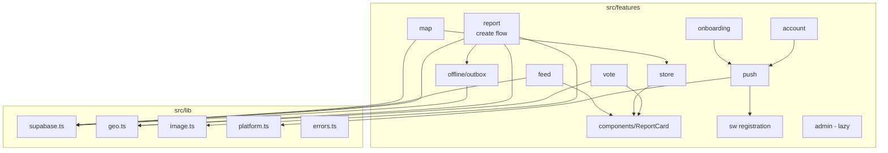

# Components

## Web App (SPA React)
**Responsibility :** UI, cache des données, géolocalisation à la volée, compression des photos, file hors ligne.
**Key Interfaces :** routes React Router, hooks `use*Query` / `use*Mutation`, client Supabase unique.
**Dependencies :** Supabase (Auth, REST, Realtime, Edge), OpenFreeMap, Géoplateforme.
**Technology Stack :** React, Vite, Tailwind, TanStack Query, Zustand, MapLibre (lazy).

## Service Worker
**Responsibility :**
- precache de la coquille ;
- cache d'exécution (tuiles, photos, polices) ;
- réception des push (`push`), ouverture (`notificationclick` → `/r/:id`) ;
- réveil Background Sync (`sync` → demande au client de vider l'outbox) ;
- invite de mise à jour.

**Technology Stack :** Workbox 7 via `vite-plugin-pwa` en `injectManifest` (`src/sw/service-worker.ts`).

## Postgres (logique métier)
**Responsibility :** données, RLS, RPC, triggers (compteurs, réputation, outbox push), cron (expiration, statistiques, reprise des push).
**Key Interfaces :** RPC listées plus haut, publication Realtime sur `reports`.

## Edge Functions
**Responsibility :** ce que Postgres ne sait pas faire : chiffrement Web Push, validation binaire et écriture Storage, suppression d'un utilisateur Auth, purge Storage.

## Scripts Node (hors runtime)
`scripts/import-osm.ts`, `scripts/generate-vapid.mjs`, `scripts/seed-demo.ts` (local uniquement), `scripts/gen-pwa-assets` (via le CLI assets-generator).

## Component Diagrams

