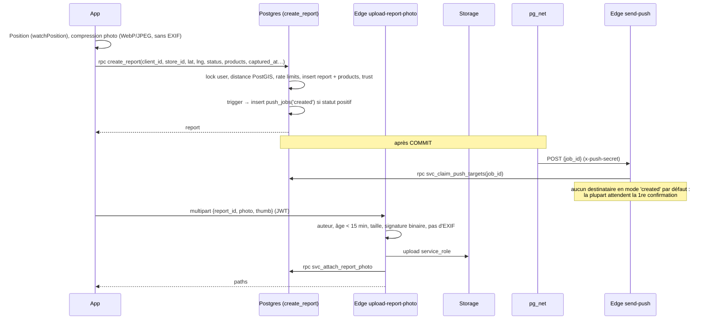
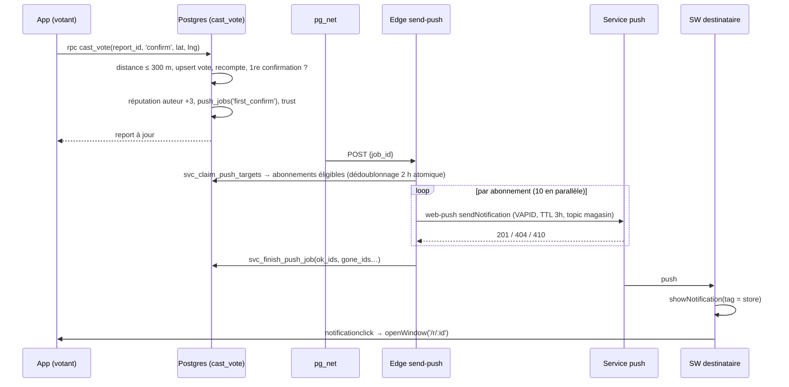
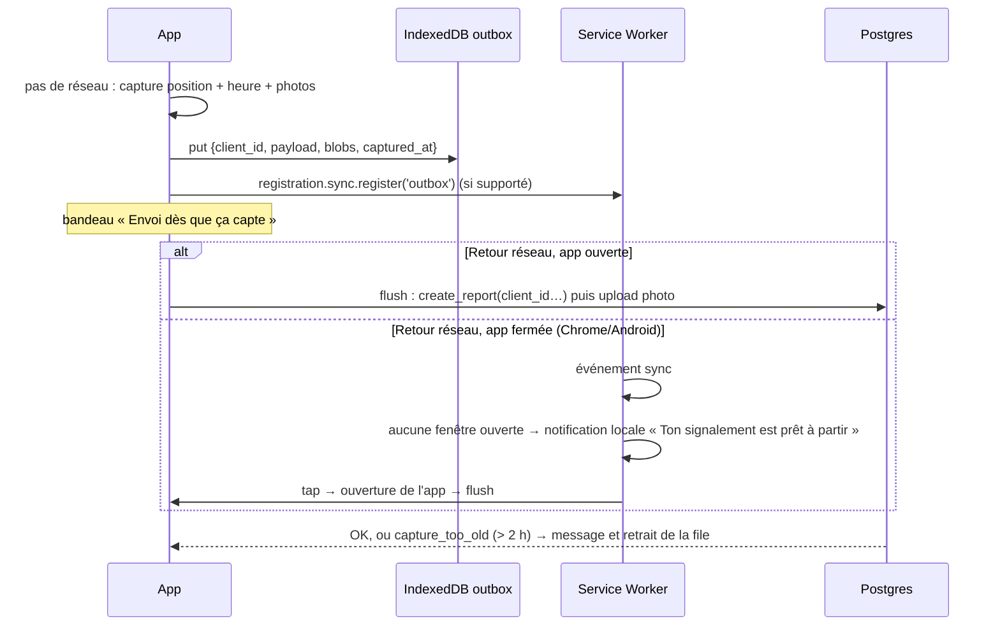

# Core Workflows

## Créer un signalement (en ligne)

## Vote et première confirmation → push

## Signalement hors ligne

*Choix assumé :* le service worker n'envoie pas lui-même les signalements. La session Supabase vit dans le contexte de la page, et la rafraîchir depuis le SW ferait tourner le refresh token en concurrence avec la page, avec un risque de déconnexion. Background Sync sert donc de **réveil**, pas de transport.

## Temps réel du fil
Le client s'abonne à `postgres_changes` (INSERT et UPDATE) sur `public.reports`. La RLS s'applique : un signalement masqué n'est jamais diffusé. Chaque évènement est filtré **côté client** : on ne garde que les `store_id` présents dans la liste des magasins chargée en cache (`get_launch_stores`), puis on applique la distance au centre de l'utilisateur (haversine, `src/lib/geo.ts`) et les filtres actifs. Une fois les informations du magasin et des produits complétées via `feed_reports`, la pastille « N nouveaux signalements » s'incrémente. L'abonnement se coupe au passage en arrière-plan (`visibilitychange`) et le rattrapage se fait au retour par refetch du fil. *Passage à l'échelle nationale :* canaux Realtime **Broadcast par département**, alimentés par trigger, au lieu des Postgres Changes globaux.
