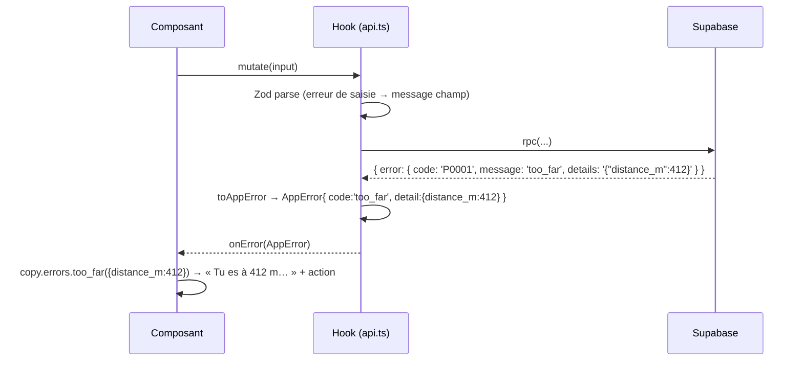

# Error Handling Strategy

## Error Flow


## Error Response Format
```typescript
export interface AppError {
  code: AppErrorCode;            // 'too_far' | 'rate_limited_user' | … | 'network' | 'unknown'
  detail?: Record<string, unknown>;
  cause?: unknown;
}
```

## Frontend Error Handling
```typescript
export function toAppError(err: unknown): AppError {
  if (isPostgrestError(err) && err.code === 'P0001') {
    return { code: asKnownCode(err.message), detail: safeJson(err.details), cause: err };
  }
  if (err instanceof TypeError && /fetch/i.test(err.message)) return { code: 'network', cause: err };
  return { code: 'unknown', cause: err };
}
```
Les erreurs réseau pendant un signalement basculent vers l'outbox. Les erreurs inconnues partent dans `log_client_error` avec un toast générique, et une ErrorBoundary est posée par route.

## Backend Error Handling
```typescript
export function jsonError(code: string, status: number, message?: string) {
  return new Response(JSON.stringify({ error: { code, message: message ?? code } }), {
    status, headers: { 'Content-Type': 'application/json', ...corsHeaders },
  });
}
```
En SQL : `private.raise_app(code, detail)` partout, sans jamais exposer d'erreur Postgres brute pour une règle métier.
