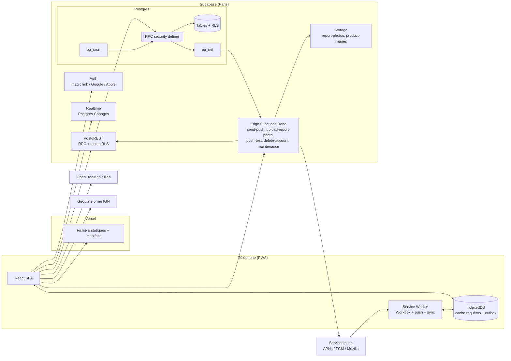

# High Level Architecture

## Technical Summary
RestockRadar est une **SPA React servie en statique** (Vercel), transformée en **PWA** par un service worker Workbox (stratégie `injectManifest`) qui gère aussi les push et la file hors ligne. Toute la logique métier sensible vit dans **Postgres** (Supabase), sous forme de **fonctions RPC `SECURITY DEFINER`** protégées par une **RLS stricte**. **PostGIS** fournit les distances, **`pg_cron`** les tâches planifiées et **`pg_net`** les appels sortants vers les **Edge Functions Deno**. Ces fonctions couvrent ce que la base ne peut pas faire seule : envoi Web Push, contrôle et stockage des photos, suppression de compte, maintenance du stockage. Le fil temps réel passe par **Supabase Realtime** (Postgres Changes), et la carte par **MapLibre** avec les tuiles **OpenFreeMap** et un style maison. L'ensemble tient dans les offres gratuites, avec des points de vigilance listés plus bas (e-mails, stockage photo, mise en pause).

## Platform and Infrastructure Choice
**Plateforme :** Supabase (offre Free) pour le back, et **Vercel (offre Hobby) — à valider** — pour le front.
**Services utilisés :**
- Supabase : Postgres 15+ (PostGIS, pg_cron, pg_net, citext), Auth (magic link, Google, Apple), Storage, Realtime, Edge Functions, Vault.
- OpenFreeMap : tuiles vectorielles OSM, glyphes et sprites.
- Géoplateforme IGN : géocodage de la ville ou du code postal, gratuit et sans clé.
- Overpass API : import ponctuel des magasins.
- Resend : SMTP des e-mails d'authentification (offre gratuite).

**Région :** Supabase `eu-west-3` (Paris), pour la latence et le RGPD. Vercel sert le front depuis son CDN mondial.

**Décisions du porteur (2026-10-14 : Tailwind v4, Vercel, rétention des photos 60 jours validés ; SMTP (D3) reporté avant ouverture publique)**

| # | Sujet | Recommandation | Alternative |
|---|---|---|---|
| D1 | Version de Tailwind | **v4** : tokens déclarés directement en CSS (`@theme`), plus besoin de `tailwind.config`, build plus rapide | v3 avec la config JS classique |
| D2 | Hébergeur front | **Vercel** : déjà utilisé sur tes autres projets, previews par branche. L'offre Hobby est réservée à l'usage non commercial, ce qui convient tant qu'il n'y a pas de monétisation | Netlify (usage commercial autorisé en gratuit) |
| D3 | E-mails d'auth | **SMTP Resend obligatoire** : l'expéditeur par défaut de Supabase est limité à quelques e-mails par heure et seulement vers les membres de l'équipe | Brevo ou un autre SMTP |
| D4 | Rétention des photos | **Purge automatique des photos après 60 jours** (le signalement reste, sans photo). Le stockage gratuit est de 1 Go, et une photo pèse environ 280 Ko avec sa vignette | 30 ou 90 jours |

**Écarts techniques imposés, à reporter dans le PRD**
1. **Géocodage :** l'API Adresse (`api-adresse.data.gouv.fr`) a été décommissionnée fin janvier 2026 au profit du **géocodeur de la Géoplateforme IGN** (`data.geopf.fr/geocodage`), fonctionnellement identique.
2. **Photos sur iOS :** Safari ne sait pas encoder en WebP via canvas (il renvoie du PNG). Le client produit du **WebP si le navigateur le supporte, sinon du JPEG** (qualité 0,82). L'EXIF est supprimé dans les deux cas, et le serveur le vérifie.
3. **Vignettes :** les transformations d'images Supabase sont réservées aux offres payantes. Le client envoie donc **deux fichiers** (1600 px et 480 px).
4. **`web-push` sous Deno :** la librairie repose sur des API Node (`crypto.createECDH`, `https`). Un spike est prévu à la story 1.6. En cas d'échec, l'architecte proposera au porteur une librairie Web Crypto compatible Deno (`@pushforge/builder` ou `web-push-browser`), sans rien changer sans son accord.
5. **Modèle de données :** `alert_radius_km` et `home_area` sortent de `profiles`, qui est lisible publiquement, pour aller dans `alert_preferences` et `user_settings`, lisibles par leur seul propriétaire. Une position, même arrondie, ne doit jamais être publique.

## Repository Structure
**Structure :** monorepo simple, sans workspaces : front à la racine, back dans `supabase/`, scripts Node dans `scripts/`.
**Monorepo Tool :** aucun (npm scripts).
**Package Organization :** un seul `package.json`. Les Edge Functions sont du Deno indépendant, avec leurs imports `npm:` et `jsr:` épinglés et un `_shared/` commun.

## High Level Architecture Diagram

## Architectural Patterns
- **Jamstack + BaaS :** SPA statique avec un back managé. *Rationale :* coût nul, aucun serveur à maintenir, scalabilité gérée par les fournisseurs.
- **Logique métier en base (« fat database ») :** les règles (distance, rate limits, votes, réputation, trust score) sont des fonctions Postgres atomiques. *Rationale :* une seule source de vérité, transactions et verrous natifs, impossible à contourner depuis un client modifié (NFR6).
- **RLS par défaut, RPC pour l'écriture :** les tables sensibles n'acceptent aucune écriture directe, tout passe par une RPC. *Rationale :* la validation et les effets de bord (compteurs, réputation, jobs push) restent cohérents.
- **Outbox transactionnelle pour les push :** un `push_jobs` est inséré dans la même transaction que l'évènement, puis `pg_net` part après commit, avec reprise par cron. *Rationale :* aucune notification pour une transaction annulée, et reprise automatique en cas d'échec.
- **Fonctions service (`svc_*`) :** les wrappers publics que seule la `service_role` peut exécuter sont l'unique passerelle des Edge Functions vers la logique privée. *Rationale :* le schéma `private` n'est pas exposé par l'API.
- **Feature folders côté front :** `src/features/<domaine>`, chacun avec ses composants, hooks, requêtes et schémas. *Rationale :* les stories sont des tranches verticales et chaque agent travaille dans un périmètre clair.
- **Server state via TanStack Query, UI state minimal (Zustand) :** *Rationale :* cache, invalidation, optimistic updates et persistance hors ligne, sans store global lourd.
- **Offline-first ciblé :** persistance du cache de requêtes et file d'envoi locale idempotente (`client_id`). *Rationale :* réseau faible au fond des hypermarchés (FR40-41).
