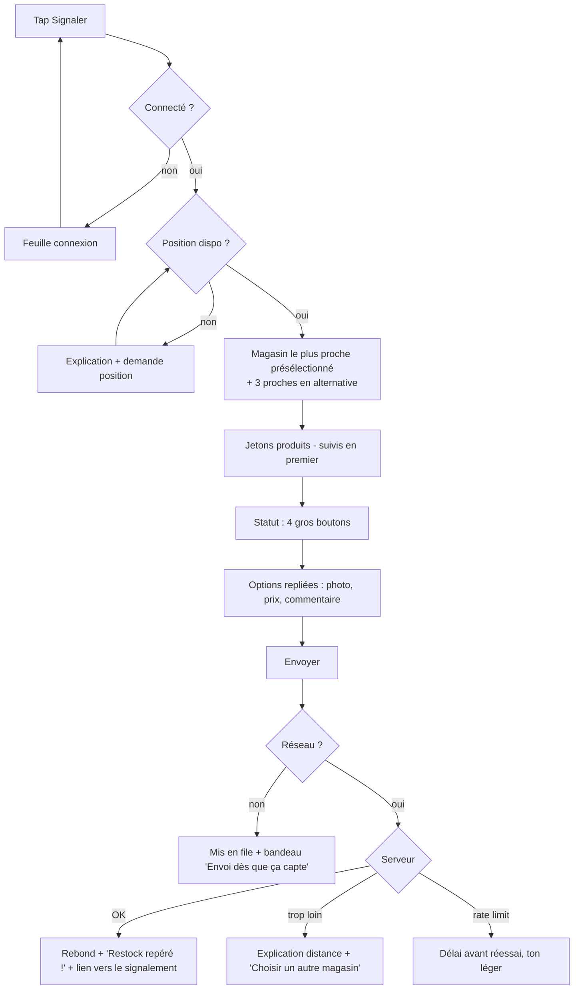
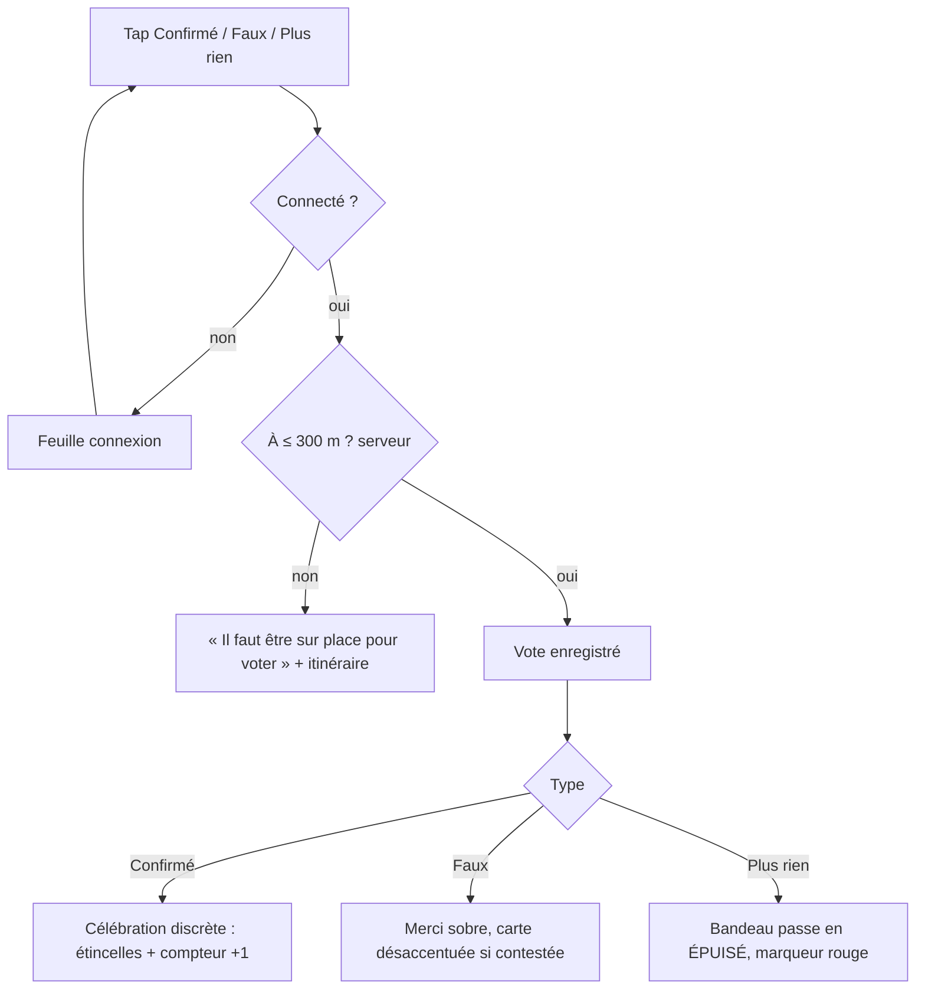
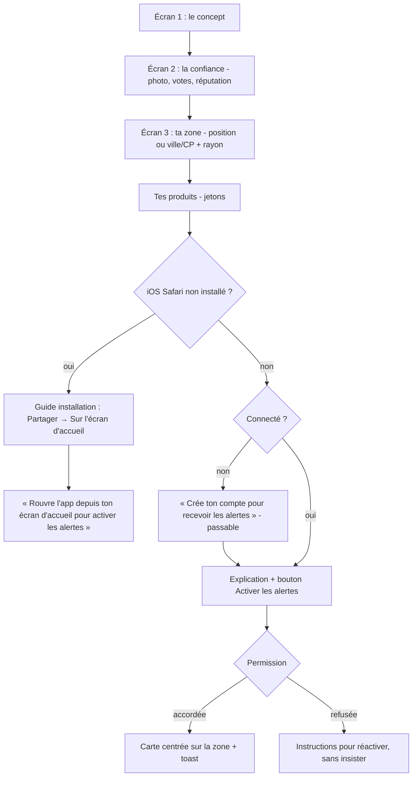

# RestockRadar UI/UX Specification

> Agent : UX Expert (Sally) — BMAD v4.33 — v1.0 du 2026-10-14
> Entrées : [`docs/prd.md`](prd.md) (v0.2), [`docs/input/initial-prompt.md`](input/initial-prompt.md) (direction artistique), phase 0 [`docs/design/phase0-directions.html`](design/phase0-directions.html) ([version publiée](https://claude.ai/artifact/UNk5P4MJTHTrji2Abbpy37)).
> **Direction retenue par le porteur : A · Classeur, avec les badges hexagonaux de la direction C** (redessinés dans le langage de A).

## Introduction

Ce document définit l'expérience, l'architecture d'information, les parcours et le système visuel de RestockRadar. Il sert de base au design détaillé et au développement front. Il complète le PRD et ne le répète pas : les règles métier (distances, seuils, barèmes) restent dans le PRD.

### Overall UX Goals & Principles

#### Target User Personas
- **Le chasseur local**, 16 à 40 ans, 84 ou 13, collectionneur régulier. Il ouvre l'app plusieurs fois par jour, souvent en mouvement ou au rayon. Il veut l'info la plus fraîche et la plus fiable possible, d'une main et en quelques secondes. Il contribue si c'est rapide et si c'est reconnu.
- **Le parent occasionnel.** Il arrive par un lien partagé ou une recherche, sans compte, souvent avant une fête. Il veut savoir « où en trouver près de chez moi » avec des mots qu'il comprend (« coffret », pas « ETB »). Il ne doit jamais tomber sur un mur d'inscription.
- **L'admin et modérateur** (le porteur). Il intervient sur mobile comme sur desktop. Il veut traiter une file vite et sans risque d'erreur.

#### Usability Goals
- **Signaler en ≤ 20 s** (médiane), d'une main, debout dans un magasin.
- **Comprendre un signalement en ≤ 2 s** : statut, magasin, distance, fraîcheur et fiabilité lisibles sans ouvrir le détail.
- **Première valeur sans compte en ≤ 10 s** : la carte ou le fil s'affiche dès la position ou la ville donnée.
- **Zéro surprise de permission** : la position et les notifications ne sont demandées qu'après une explication et une action explicite.
- **Zéro cul-de-sac** : chaque état vide, d'erreur ou hors ligne propose une action.

#### Design Principles
1. **L'objet avant l'écran.** Chaque élément important (signalement, badge, marqueur) est un objet de collection qu'on a envie de toucher : cadre, relief, enfoncement au tap. Le reste de l'interface reste calme pour leur laisser la place.
2. **Le statut d'abord, toujours par deux canaux.** Le statut se lit par la couleur **et** par une icône ou un libellé, jamais par la couleur seule.
3. **Le pouce commande.** Les actions sont dans le tiers bas de l'écran, et les cibles font au moins 44 px.
4. **Une audace par écran.** Le rouge ne sert qu'à « Signaler » et aux alertes, le jaune aux célébrations. L'holo est rare, donc précieux.
5. **Le ton fait partie du design.** Le vocabulaire est complice et chasseur, dosé, et ne rend jamais une erreur floue.

#### Change Log
| Date | Version | Description | Author |
|---|---|---|---|
| 2026-10-14 | 1.0 | Spec initiale après le choix de la direction A + badges C | UX Expert (Sally) |

## Information Architecture (IA)

### Site Map / Screen Inventory

```mermaid
graph TD
  ROOT[Coquille app + barre d'onglets] --> MAP[Carte /]
  ROOT --> FEED[Fil /fil]
  ROOT --> REPORT[Signaler /signaler]
  ROOT --> ACCOUNT[Compte /compte]
  MAP --> LIST[Vue liste /?vue=liste]
  MAP --> SHEET[Feuille aperçu magasin]
  SHEET --> STORE[Fiche magasin /m/:id]
  STORE --> HIST[Historique + heatmap]
  STORE --> PROPOSE[Proposer un magasin /m/proposer]
  FEED --> DETAIL[Détail signalement /r/:id]
  DETAIL --> ABUSE[Signaler un abus - feuille]
  REPORT --> REPORT_OK[Confirmation animée]
  ACCOUNT --> LOGIN[Connexion /connexion]
  ACCOUNT --> PREFS[Préférences d'alerte /compte/alertes]
  ACCOUNT --> MINE[Mes signalements /compte/signalements]
  ACCOUNT --> FAVS[Favoris /compte/favoris]
  ACCOUNT --> DATA[Mes données : export / suppression /compte/donnees]
  ACCOUNT --> LEGAL[Mentions / Confidentialité / CGU /legal/*]
  ROOT --> ONB[Onboarding /bienvenue]
  ONB --> IOS[Guide installation iOS]
  ONB --> PUSH[Activer les alertes]
  ROOT --> ADMIN[Admin /admin - lazy, rôle]
  ADMIN --> A1[Catalogue]
  ADMIN --> A2[Magasins proposés]
  ADMIN --> A3[Modération]
  ADMIN --> A4[Utilisateurs]
  ROOT --> DESIGN[/design - dev only]
```

### Navigation Structure

**Navigation principale.** Une barre d'onglets basse fixe à 4 positions : **Carte**, **Fil**, un bouton central **Signaler** et **Compte**.
- Hauteur de 64 px, plus la zone sûre du bas.
- Le bouton Signaler est un « bouton-objet » rouge de 60 px qui déborde de 12 px au-dessus de la barre (relief A).
- L'onglet actif porte un fond de jeton papier et un libellé en gras. Les libellés restent toujours visibles (pas d'icône seule).
- Un appui sur l'onglet actif remonte en haut de la page.

**Navigation secondaire.**
- Le haut d'écran porte un en-tête contextuel : titre, retour, une action à droite.
- Dans la Carte, les filtres et la bascule carte/liste sont des jetons flottants en haut. Dans le Fil, ce sont des jetons collants sous l'en-tête.

**Fil d'Ariane.** Aucun : l'app est peu profonde (3 niveaux au maximum). Le retour système est respecté (bouton retour Android, geste iOS), et les feuilles glissantes se ferment au retour.

**Visiteur anonyme.** Mêmes onglets. « Signaler » ouvre une feuille « Connecte-toi pour signaler » (magic link, Google ou Apple), puis l'utilisateur revient à son action une fois connecté.

**Admin.** Accès par un lien « Espace admin » dans le Compte (visible seulement pour le rôle admin). Sa propre navigation : onglets en haut sur mobile, rail latéral au-delà de 1024 px.

## User Flows

### Flow 1 — Signaler un restock

**User Goal :** prévenir la communauté qu'un produit est en rayon, en ≤ 20 s.
**Entry Points :** bouton central « Signaler », bouton « Signaler ici » de la fiche magasin, raccourci de l'icône d'app (manifest `shortcuts`).
**Success Criteria :** le signalement est accepté par le serveur, l'animation de confirmation est jouée, et le signalement apparaît dans le fil.



**Edge Cases & Error Handling :**
- Aucun magasin à moins de 300 m : un message « Aucun magasin à portée » s'affiche avec deux options, « Proposer ce magasin » ou « Voir les plus proches ». Les utilisateurs à haute réputation voient en plus « Signaler à distance ».
- Position imprécise (précision GPS > 100 m) : un avertissement doux invite à sortir de la galerie ou à réessayer.
- Échec de l'upload de la photo : le signalement part sans photo, avec un toast « Photo non envoyée, ton signalement est bien parti ».
- Double tap sur Envoyer : le bouton est verrouillé pendant l'envoi.
- Produit absent du catalogue : un lien « Il manque un produit ? » envoie une suggestion à l'admin (V1 : texte libre dans le commentaire).

**Notes :** les étapes Magasin, Produits et Statut tiennent sur **un seul écran** qui se déroule (pas d'assistant multi-pages). Les choix sont mémorisés pendant 30 min pour un second signalement dans le même magasin.

### Flow 2 — Voter sur un signalement

**User Goal :** confirmer ou corriger une info, sur place.
**Entry Points :** carte de signalement (fil ou feuille magasin), détail `/r/:id`, ouverture depuis une notification.
**Success Criteria :** le vote est enregistré, le compteur et le badge de fiabilité se mettent à jour, et un retour positif est donné.



**Edge Cases & Error Handling :**
- Vote sur son propre signalement : les boutons sont remplacés par « Ton signalement · 5 confirmations ».
- Signalement expiré : les votes sont désactivés, avec le libellé « Expiré il y a 2 h ».
- Changement d'avis : un nouveau tap sur un autre choix remplace le vote, et le choix actif est visiblement « enfoncé ».

### Flow 3 — Onboarding et activation des alertes

**User Goal :** voir ce qui compte pour soi, puis être alerté.
**Entry Points :** premier lancement, « Revoir l'introduction » dans le Compte.
**Success Criteria :** zone et produits définis, alertes actives (ou refus explicite et respecté).



**Edge Cases & Error Handling :**
- Position refusée : on bascule sur le champ ville ou code postal (API Adresse), sans message culpabilisant.
- L'app est installée sur iOS mais la permission a été refusée auparavant : on affiche le chemin Réglages → Notifications → RestockRadar.
- Navigateur sans Web Push : on l'explique et on propose la carte et le fil sans alertes.
- Chaque écran est passable, avec « Passer » en haut à droite.

### Flow 4 — Recevoir une alerte et y aller

**User Goal :** décider en quelques secondes si ça vaut le déplacement.
**Entry Points :** notification push.
**Success Criteria :** le détail s'ouvre en moins d'une seconde (depuis le cache si nécessaire), et l'itinéraire est lancé en un tap.

```mermaid
graph TD
  N[Notification 'Restock repéré chez Cultura Le Pontet'] --> T[Tap]
  T --> D[/r/:id - détail]
  D --> Y[Y aller → app de navigation native]
  D --> V[Une fois sur place : voter]
```

**Edge Cases :** si le signalement est épuisé entre-temps, le détail l'affiche en tête (« Épuisé depuis 14 h 32 ») et propose « Voir les autres magasins proches ». Hors ligne, le détail vient du cache, avec la mention de l'heure de mise à jour.

### Flow 5 — Modérer (admin)

**User Goal :** traiter la file sans erreur.
**Entry Points :** Compte → Espace admin → Modération.
**Success Criteria :** chaque élément est traité (masquer ou rejeter), l'action est journalisée, et l'annulation reste possible pendant 5 s.

**Edge Cases :** le bannissement passe par une confirmation intégrée à la page, où l'admin doit taper le pseudo de l'utilisateur (aucune boîte de dialogue native). Les actions destructives se défont depuis un toast « Annuler ».

## Wireframes & Mockups

**Primary Design Files :** pas de Figma. Le design de référence vit dans le code : tokens, plus la page `/design` (story 1.2). Les style tiles de phase 0 servent de point de départ. Des captures mobiles des écrans clés seront produites à chaque phase pour validation.

### Key Screen Layouts

#### Carte (accueil)
**Purpose :** voir d'un coup d'œil où il y a du stock autour de soi.
**Key Elements :**
- La carte occupe tout l'écran, avec un fond OpenFreeMap restylé dans les tons papier et encre (style MapLibre personnalisé : routes crème, eau en bleu désaturé, libellés en encre).
- En haut, des jetons flottants : zone (« Pertuis · 15 km »), filtres et bascule Carte/Liste.
- Marqueurs « étiquette de prix » par statut et groupes ronds jaunes.
- En bas à droite, un bouton rond « Autour de moi » (52 px), au-dessus de la barre d'onglets.
- Un tap sur un marqueur ouvre une feuille glissante : aperçu du magasin et du dernier signalement en mini-carte. On la tire vers le haut pour obtenir la fiche complète.
- L'attribution OSM figure en petit, en bas à gauche.

**Interaction Notes :** la feuille a 3 crans (fermée, aperçu 40 %, fiche 92 %). La carte reste interactive sous la feuille en mode aperçu.

#### Fil
**Purpose :** suivre ce qui se passe maintenant.
**Key Elements :**
- En-tête « Autour de toi » avec la zone, et des jetons de filtres collants (Produits, Enseignes, Fraîcheur).
- Une pastille « 3 nouveaux signalements » apparaît en haut quand du temps réel arrive.
- Les cartes de signalement s'empilent avec un gap de 16 px, en chargement progressif.
- Les signalements contestés sont à 60 % d'opacité, avec le bandeau « Contesté ».

#### Signaler
**Purpose :** contribuer en 20 s.
**Key Elements :**
- Une seule colonne, du haut vers le bas : la carte « magasin » présélectionné (nom, distance, « Changer »), une grille de jetons produits sur 2 lignes défilables, les 4 boutons de statut en grille 2×2 (72 px de haut, icône et libellé) et un repli « Ajouter une photo (+1 réputation) · Prix · Commentaire ».
- Le bouton « Envoyer » est collé en bas, pleine largeur, en rouge.

#### Fiche magasin
**Key Elements :**
- En-tête avec le nom (display), l'enseigne en jeton et la mention « Ouvert · ferme à 20 h ».
- Une rangée d'actions : Y aller, Favori, Signaler ici.
- Le dernier signalement valide en grande carte.
- Le « Calendrier de chasse » (heatmap jour × heure).
- L'historique en liste compacte.

#### Détail signalement
**Key Elements :**
- La carte de signalement en grand format, avec la photo plein cadre qu'on peut toucher pour zoomer.
- Les 3 boutons de vote en barre basse collée.
- L'auteur avec son badge, puis les liens « Fiche magasin » et « Signaler un abus » (discret).

#### Compte
**Key Elements :**
- Une « carte dresseur » : avatar maison, pseudo, score, et sa vitrine de badges hexagonaux (les badges obtenus sont colorés, les autres en contour pointillé, avec la progression).
- Une liste de sections : Alertes, Mes signalements, Favoris, Mes données, Légal, Déconnexion.

## Component Library / Design System

**Design System Approach :** système maison et léger, sans librairie de composants stylés (pas de shadcn par défaut). Les primitives accessibles « headless » sont autorisées quand elles évitent de réinventer l'accessibilité (focus trap des feuilles, menus) : choix à faire par l'architecte, par exemple Radix primitives ou React Aria, sans aucun style importé. Tous les styles passent par des tokens.

### Core Components

#### PressButton
**Purpose :** action principale et secondaire, avec le relief « touche ».
**Variants :** `primary` (rouge), `secondary` (pochette, bordure encre), `ghost` (texte seul), `danger` (contour rouge), `icon` (rond, 52 px).
**States :** repos (ombre pleine de 5 px en encre), survol (ombre colorée diffuse), **enfoncé** (translation de 4 px, ombre de 1 px), focus (anneau de 3 px en `--focus`), désactivé (aplat `--paper-2`, sans relief), chargement (mini-loader « étincelle » qui tourne, libellé conservé).
**Usage Guidelines :** un seul `primary` par écran, d'une hauteur minimale de 52 px. Le libellé est un verbe d'action (« Signaler », « Y aller »).

#### Chip (jeton)
**Purpose :** sélection multiple (produits, enseignes, filtres).
**Variants :** `toggle`, `filter` (avec compteur), `brand` (couleur secondaire d'enseigne).
**States :** off (pochette avec bordure de 2 px), on (fond jaune Électrik et texte encre), focus et désactivé. Le rôle `aria-pressed` est obligatoire.

#### ReportCard (composant signature)
**Purpose :** afficher un signalement comme une carte à collectionner.
**Anatomy :**
1. **Cadre** : pochette, bordure encre de 3 px, `radius-lg` (24), ombre pleine de 7 px en encre.
2. **Bandeau de statut** : couleur du statut, icône et libellé en capitales Fredoka large, avec la **rareté** à droite (1 à 3 étincelles selon le `trust_score`).
3. **Fenêtre photo** : `radius-md` (16), bordure de 2 px. Sans photo, un rayonnage illustré maison (boîtes génériques) avec « Pas de photo ».
4. **Corps** : magasin (display), distance, âge, auteur et badge, jetons produits.
5. **Pied** : séparateur pointillé, nombre de confirmations, boutons de vote.

**Variants :** `full` (fil, détail), `compact` (feuille magasin, historique : bandeau et une ligne), `mini` (aperçu carte).
**States :** normal, **holo** (`trust_score` ≥ 80), contesté (opacité 60 % et bandeau « Contesté » hachuré), épuisé (bandeau rouge), expiré (désaturé, bandeau « Expiré »), signalé à distance (pastille « À distance » sur le bandeau), en file hors ligne (contour pointillé et « En attente d'envoi »).

#### Holo (effet)
**Purpose :** récompense visuelle rare.
**Implémentation :** une couche `::after` combinant un dégradé arc-en-ciel répété (opacité ~20 %) et un reflet radial qui suit le pointeur, en `mix-blend-mode: overlay`, piloté par les variables `--mx`, `--my` et `--ang`.
- Sur mobile : dérive lente automatique, plus l'inclinaison de l'appareil (`deviceorientation`) si la permission est disponible, sans jamais la demander pour ça.
- Sous `prefers-reduced-motion`, l'effet est figé à 50 % d'opacité.
- **Réservé** aux ReportCard de fiabilité ≥ 80 et aux badges.
- Code original, sans rien reprendre de poke-holo (licence GPL-3).

#### MapMarker
**Purpose :** statut d'un magasin sur la carte.
**Forme :** « étiquette de prix » carrée de 44 px, `radius-sm` (10), bordure encre de 3 px, petite pointe en bas et icône centrée.

| Statut | Fond (clair / sombre) | Icône |
|---|---|---|
| En stock | `--status-ok` | coche, blanc (clair) / encre nuit (sombre) |
| Stock faible | `--status-low` | barres, **encre** |
| Épuisé | `--status-out` | croix |
| Restock annoncé | `--status-soon` | horloge |
| Rien de récent | `--status-none` | tiret |
| Groupe | `--yellow`, rond | nombre en Fredoka |

**States :** sélectionné (agrandi à 1,15, plus un halo jaune), frais (< 30 min : léger rebond à l'apparition, une seule fois).
**Implémentation :** les marqueurs sont dessinés en images SVG dans le style MapLibre (symbol layer), pas en DOM, pour tenir la performance avec des centaines de magasins.

#### ReputationBadge (badges hexagonaux, repris de C)
**Purpose :** badges à collectionner, façon badges d'arène, avec un dessin original.
**Anatomy :** hexagone à pointe en haut (viewBox 64×64), contour **encre de 3,5 px** (langage A), cœur papier `--paper-2` inset et emblème au trait de 3 px dans la couleur du badge.

| Badge | Couleur | Emblème |
|---|---|---|
| Nouveau | `--status-ok` | pousse |
| Fiable | `--status-soon` | coche |
| Éclaireur | `--yellow` + **holo** | boussole |
| Vétéran | `--red` + **holo** | étincelle triple |

**Sizes :** 20 px (inline après un pseudo, emblème seul), 40 px (cartes), 64 px (vitrine du Compte).
**States :** obtenu, verrouillé (contour pointillé `--ink-2` à 40 %, emblème masqué, progression « 18/30 pts »), juste obtenu (animation de « frappe » : scale 0.6 → 1.08 → 1, avec des étincelles).

#### Sheet (feuille glissante)
3 crans, poignée visible, focus piégé quand elle est ouverte en plein, fermeture par glissement, échap ou retour. Fond pochette, `radius-xl` (32) en haut, ombre encre douce.

#### Toast
En bas, au-dessus de la barre d'onglets, avec `aria-live="polite"`. Variante « Annuler » à 5 s.

#### EmptyState
Illustration maison (voir Branding), un titre display, une ligne de ton et **une action**. Exemples :
- fil vide : « Calme plat dans le coin. Sois l'éclaireur du jour ! » avec le bouton « Signaler » ;
- hors ligne : « Pas de réseau au fond du rayon ? On garde tes signalements au chaud. ».

#### Skeleton / chargement
Les cartes squelettes reprennent la forme exacte de ReportCard (bandeau, fenêtre, lignes) avec une lueur papier qui glisse. Le chargement long (> 2 s) affiche une ligne de ton tournante (« On fait le tour des rayons… », « On secoue les boosters… »).

#### Heatmap « Calendrier de chasse »
Grille 7 jours × créneaux de 2 h (8 h à 22 h). Les cases sont arrondies (`radius-xs`, 6), en échelle séquentielle de 5 pas du papier vers le vert. Un tableau alternatif est accessible par « Voir en tableau ». La légende est en texte (« Souvent », « Parfois », « Rarement »).

## Branding & Style Guide

### Visual Identity
**Concept « Classeur »** : l'app est un classeur de collection posé sur la table. Le papier crème sert de fond, l'encre bleu nuit les textes et les traits épais. Les éléments importants sont des objets (cartes en pochette, pins, étiquettes) avec relief et ombre pleine. Les badges reprennent la forme hexagonale « puce » de la direction C, tracés à l'encre comme le reste.

**Illustrations maison** (états vides, onboarding, guide iOS) :
- trait encre de 3 px, aplats de la palette, formes rondes ;
- motifs : un **sac à dos d'explorateur**, une **lampe torche**, des **rayonnages** et des **boîtes génériques**, une **loupe** ;
- aucun personnage ou créature qui évoque un Pokémon, aucune sphère bicolore.

La mascotte éventuelle sera un objet (la lampe torche « qui cherche »), pas une créature.

**Nom et logo :** le nom de travail RestockRadar vient de la config. Le logotype provisoire est le nom en Fredoka large 600 avec un hexagone-radar maison, à valider plus tard (avant la phase 5).

### Color Palette

Tokens sémantiques, consommés par Tailwind via des variables CSS. Les contrastes ont été vérifiés (ratios WCAG) le 2026-10-14.

| Token | Clair | Sombre (« classeur de nuit ») | Usage |
|---|---|---|---|
| `--paper` | `#F6EFDF` | `#0F1830` | fond d'app |
| `--paper-2` | `#EDE2C8` | `#16213F` | surfaces en creux, jetons produits, cases vides |
| `--card` | `#FFFBF2` | `#1C2A4E` | pochettes, feuilles, cartes |
| `--ink` | `#1B2A4A` | `#F3EAD6` | texte principal, traits, ombres pleines (12,4:1 / 14,7:1) |
| `--ink-2` | `#4A5876` | `#AEB6CB` | texte secondaire (6,2:1 / 6,9:1) |
| `--red` | `#D63A28` | `#FF5A45` | action principale, alertes. **Jamais pour du texte courant.** |
| `--on-red` | `#FFFFFF` | `#0F1830` | texte sur rouge (4,7:1 / 5,7:1) |
| `--red-shadow` | `#9C2516` | `#8E1F12` | lueur colorée sous le bouton primaire |
| `--yellow` | `#FFC93C` | `#FFD25A` | accent, jetons actifs, célébrations, groupes ; texte encre `#1B2A4A` dessus (9,3:1) |
| `--status-ok` | `#237A46` | `#4CC57E` | en stock (blanc dessus 5,3:1 / encre nuit 8,0:1) |
| `--status-low` | `#E07B16` | `#FFA24A` | stock faible (**icône encre**, 4,75:1 / 8,8:1) |
| `--status-out` | `#D63A28` | `#FF5A45` | épuisé |
| `--status-soon` | `#2F6FCC` | `#6FA8FF` | restock annoncé (4,9:1 / 7,3:1) |
| `--status-none` | `#737B8F` | `#6F7893` | rien de récent (4,2:1 / 4,0:1) |
| `--focus` | `#2F6FCC` | `#FFD25A` | anneau de focus |

**Palette secondaire « types »** (catégories de produits et d'enseignes, toujours avec un libellé) :
- Feu `#E8794A`
- Eau `#4C8FC4`
- Plante `#5E9E6B`
- Électrik `#E8B730`
- Psy `#A774B8`
- Roche `#A08A6A`

Le mode sombre en reprend des versions éclaircies de 15 %. Elle est désaturée pour ne jamais concurrencer les statuts.

**Mode sombre « classeur de nuit » :** bleu nuit profond, encre devenue crème, ombres pleines en `#070C1C`. Ce n'est pas une inversion : la hiérarchie est conservée et le relief garde son ombre pleine.

### Typography

#### Font Families
- **Display :** **Fredoka** (variable, axes `wdth` 75-125 et `wght` 300-700), utilisée en **chasse large (`wdth` 112-118)** et en graisse 500 à 600. **Interdits :** graisse 700 en chasse normale (trop enfantine) et toute ligne longue en Fredoka.
- **Texte :** **Figtree** (400, 500, 700).
- **Chiffres et relevés :** Figtree en `tabular-nums`, sans monospace séparée.
- **Hébergement :** les fichiers WOFF2 sont **auto-hébergés** (sous-ensemble latin et latin-ext), en `font-display: swap`, avec préchargement de la display. Aucun appel à Google Fonts en production (RGPD).

#### Type Scale
| Element | Taille | Graisse | Line height | Police |
|---|---|---|---|---|
| Display (onboarding, célébrations) | 34px | 600 | 1.05 | Fredoka wdth 115 |
| H1 (titre d'écran) | 28px | 600 | 1.1 | Fredoka wdth 112 |
| H2 (sections, nom magasin) | 22px | 600 | 1.15 | Fredoka wdth 110 |
| H3 (titre de carte) | 19px | 600 | 1.2 | Fredoka wdth 108 |
| Bandeau de statut | 15px | 600, capitales, +0.02em | 1 | Fredoka wdth 118 |
| Body | 16px | 400 | 1.55 | Figtree |
| Small | 14px | 500 | 1.45 | Figtree |
| Caption / méta | 13px | 500 | 1.4 | Figtree |
| Label | 12px | 700, capitales, +0.08em | 1 | Figtree |

### Iconography
**Icon Library :** **Phosphor Icons, graisse « Bold »**, en import à l'unité (tree-shaking). Elles ont des terminaisons arrondies et un trait épais qui s'accorde avec le trait encre.
**Pictos maison :** l'étincelle de rareté, l'emblème de chaque badge et les icônes de statut si Phosphor ne colle pas. Ils sont dessinés sur la même grille de 24 px, avec un trait de 2,2 px et des bouts ronds.
**Usage Guidelines :** les icônes de 20 à 24 px sont toujours accompagnées d'un libellé dans la navigation. Une icône seule (bouton rond) porte un `aria-label`. **Aucun emoji** dans l'interface.

### Spacing & Layout
- **Grille :** une colonne sur mobile, gouttières latérales de 16 px (20 px au-delà de 400 px). Au-delà de 1024 px, la carte et le fil passent côte à côte (carte à gauche, fil ou fiche à droite).
- **Espacements (base 4) :** `--space-1` 4, `-2` 8, `-3` 12, `-4` 16, `-5` 20, `-6` 24, `-8` 32, `-10` 40, `-12` 48.
- **Radius :**
  - `--radius-xs` 6 (cases de heatmap) ;
  - `--radius-sm` 10 (marqueurs, petits jetons carrés) ;
  - `--radius-md` 16 (fenêtres photo, champs) ;
  - `--radius-lg` 24 (cartes) ;
  - `--radius-xl` 32 (feuilles, tuiles d'onboarding) ;
  - `--radius-pill` 999 (jetons, boutons ronds, groupes).

  Les boutons utilisent 18, une exception documentée entre md et lg qui reste dans l'échelle des tokens sous le nom `--radius-button`.
- **Bordures :** `--stroke-1` 2px (jetons, champs), `--stroke-2` 3px (cartes, boutons, marqueurs).
- **Ombres (toujours colorées, jamais grises) :**
  - `--shadow-press` : `0 5px 0 var(--ink)` ;
  - `--shadow-card` : `0 7px 0 var(--ink)` ;
  - `--shadow-pressed` : `0 1px 0 var(--ink)` ;
  - `--glow-red` : `0 10px 18px -6px color-mix(in srgb, var(--red) 55%, transparent)` ;
  - `--shadow-sheet` : `0 -8px 30px -12px color-mix(in srgb, var(--ink) 45%, transparent)`.

## Accessibility Requirements

### Compliance Target
**Standard :** WCAG 2.2 niveau AA.

### Key Requirements
**Visuel :**
- Contrastes : texte ≥ 4,5:1, grand texte et composants d'interface ≥ 3:1, vérifiés pour chaque paire de tokens dans les deux thèmes (tableau ci-dessus, contrôle automatisé en story 1.2).
- Focus : anneau de 3 px `--focus` avec un décalage de 3 px, toujours visible au clavier (`:focus-visible`).
- Texte : pas de taille sous 13 px, et zoom navigateur à 200 % sans perte.

**Interaction :**
- Clavier : tout est atteignable. Les feuilles piègent le focus et le rendent à la fermeture. La carte a son équivalent en liste.
- Lecteur d'écran :
  - landmarks (`nav`, `main`) ;
  - libellés de statut en texte (« En stock, fiabilité 3 sur 3, 5 confirmations, il y a 12 minutes ») ;
  - `aria-live` pour la pastille de nouveaux signalements et pour les toasts.
- Cibles tactiles ≥ 44 × 44 px, espacées d'au moins 8 px.

**Contenu :**
- Photos de signalement : alternative générée (« Photo du rayon, Cultura Le Pontet, 14 h 20 »).
- Titres : un seul H1 par écran, hiérarchie stricte.
- Formulaires : labels visibles, erreurs reliées par `aria-describedby`, sans placeholder utilisé comme label.

### Testing Strategy
- axe-core dans les tests Playwright sur chaque écran principal.
- Test manuel VoiceOver iOS et TalkBack Android sur les flows 1 à 4, à chaque epic.
- Navigation clavier testée sur desktop.
- Script de vérification des contrastes des tokens en CI (story 1.2).

## Responsiveness Strategy

### Breakpoints
| Breakpoint | Min Width | Max Width | Target Devices |
|---|---|---|---|
| Mobile | 320px | 599px | iPhone SE à Pro Max, Android |
| Tablet | 600px | 1023px | tablettes, petits laptops |
| Desktop | 1024px | 1439px | ordinateurs |
| Wide | 1440px | — | grands écrans |

### Adaptation Patterns
- **Mobile :** la référence. Barre d'onglets basse, feuilles glissantes.
- **Tablette :** même structure, avec un fil sur 2 colonnes de cartes et une feuille plafonnée à 560 px de large.
- **Desktop et Wide :** la barre d'onglets devient un rail vertical à gauche. La carte et le panneau (fil ou fiche) sont côte à côte, avec un panneau de 420 à 520 px et la carte qui occupe le reste. **Pas de conteneur centré étroit** : l'écran est utilisé en entier (le porteur travaille sur un 32").
- **Mode installé :** zones sûres respectées (`env(safe-area-inset-*)`), aucun lien « Installer » affiché.

## Animation & Micro-interactions

### Motion Principles
- Le mouvement **explique** (d'où vient la fiche, où part le vote) ou **récompense** (signalement envoyé, vote confirmé). Jamais de décoration permanente, à part la dérive holo.
- Il est court et ressort : courbe `--ease-spring` pour les objets, `--ease-out` pour les panneaux.
- Sous `prefers-reduced-motion`, les translations et rebonds deviennent de simples fondus de 120 ms, et l'holo est figé.
- Les animations n'utilisent que `transform` et `opacity`.

**Tokens de durée :**
- `--dur-tap` 90ms
- `--dur-fast` 160ms
- `--dur-base` 240ms
- `--dur-slow` 420ms
- `--dur-celebrate` 700ms

**Courbes :**
- `--ease-out` cubic-bezier(.16,1,.3,1)
- `--ease-spring` cubic-bezier(.34,1.56,.64,1)

### Key Animations
- **Enfoncement au tap :** translateY de 4 px et ombre pleine qui s'écrase (`--dur-tap`, linéaire).
- **Signalement envoyé :** la carte saute (scale 0.96 → 1.04 → 1), le bandeau se colore et 5 étincelles jaunes jaillissent, avec le titre « Restock repéré ! » (`--dur-celebrate`, spring). Vibration courte (`navigator.vibrate(12)`) quand c'est disponible.
- **Vote « Confirmé » :** le compteur roule (+1) et 3 étincelles sortent du bouton (`--dur-slow`).
- **Nouveau badge :** frappe du badge (scale 0.6 → 1.08 → 1) et reflet holo qui traverse une fois.
- **Carte → fiche :** la feuille monte avec un spring amorti (`--dur-base`). La mini-carte s'agrandit en fiche (View Transitions API quand elle est disponible, fondu sinon).
- **Marqueur frais :** léger rebond d'apparition, une seule fois, à moins de 30 min.
- **Nouveaux signalements :** la pastille glisse depuis le haut. Au tap, défilement doux vers le haut, puis apparition des cartes en cascade (60 ms d'écart, 5 cartes au maximum).
- **Chargement :** lueur papier sur les squelettes (1,4 s, en boucle, désactivée sous reduced-motion).

## Performance Considerations

### Performance Goals
- **Page Load :** LCP < 2,5 s en 4G sur le Fil et la Fiche, bundle initial < 200 ko gzip. MapLibre est chargé à la demande (la carte affiche un squelette papier en attendant).
- **Interaction Response :** INP < 200 ms. Le retour visuel d'un tap est immédiat (< 50 ms), avec des mises à jour optimistes pour les votes et les favoris.
- **Animation FPS :** 60 fps visés, en `transform` et `opacity` uniquement.

### Design Strategies
- Polices limitées à 2 familles, sous-ensembles latins, display préchargée.
- Illustrations en SVG inline optimisé, sans images matricielles décoratives.
- Photos en vignettes WebP de 480 px dans le fil (variantes générées à l'upload ou transformations Storage), plein format seulement au détail, `loading="lazy"` et dimensions fixées (pas de CLS).
- Couche holo désactivée hors écran (`content-visibility` et IntersectionObserver).
- Marqueurs de carte en sprites SVG MapLibre plutôt qu'en DOM.

## Next Steps

### Immediate Actions
1. Le porteur relit cette spec. Elle peut être revue en parallèle de l'architecture.
2. **Architecte :** produire `docs/architecture.md` (arborescence, SQL et RLS, Edge Functions, service worker), en tenant compte des contraintes de cette spec : style MapLibre personnalisé, sprites de marqueurs, View Transitions, primitives headless, auto-hébergement des polices, variantes de photos.
3. Mettre à jour la page de phase 0 avec un aperçu de la direction retenue (A + badges C) pour validation visuelle finale.
4. Story 1.2 : implémenter les tokens et la page `/design` à partir des sections Color Palette, Typography, Spacing & Layout, Animation et Core Components.

### Design Handoff Checklist
- [x] All user flows documented
- [x] Component inventory complete
- [x] Accessibility requirements defined
- [x] Responsive strategy clear
- [x] Brand guidelines incorporated
- [x] Performance goals established

## Checklist Results
Pas de check-list UX dédiée dans BMAD v4.33. La cohérence avec le PRD sera vérifiée par le PO (`po-master-checklist`) après l'architecture.
